# Activity 1 - Act1_Activity202606241600

## Source Code

```vbnet
Module Module1

    Sub Main()
        Console.WriteLine("Activity202606241600")
        Console.WriteLine("Author: Alvarez, Rex")

        Dim theName = "Alvarez, Rex"
        Console.WriteLine("Hello " + theName)

        Dim n1 As Integer = 0
        Dim n2 As Double = 0.0
        Dim isValid As Boolean = True
        Dim character As Char = "A"
        Dim number1 As Integer = 12
        Dim number2 As Double = 12.12

        Console.ReadKey()
    End Sub

End Module
```

## Sample Run

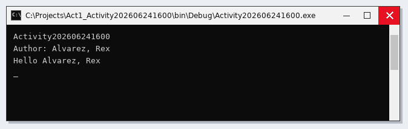

---

# Activity 2 - Act2 Celcius-Fahrenheit Converter

## Source Code

```vbnet
Module Module1

    Sub Main()
        Console.Write("Hello world")
        Console.ReadLine()

        Dim lastName As String = ""
        Dim firstName As String = ""

        Console.Write("Enter Lastname: ")
        lastName = Console.ReadLine()
        Console.Write("Enter Firstname: ")
        firstName = Console.ReadLine()

        Console.WriteLine("Your Lastname is " + lastName)
        Console.WriteLine("Your Firstname is " + firstName)
        Console.ReadLine()

        ' Converter 1: Celsius to Fahrenheit
        Console.WriteLine("--- Celsius to Fahrenheit Converter ---" & vbNewLine)
        Console.Write("Enter Celsius: ")
        Dim celsiusInput As Decimal = Convert.ToDecimal(Console.ReadLine())
        Dim fahrenheitResult As Decimal = (celsiusInput * 1.8) + 32
        Console.WriteLine("Result in Fahrenheit: " & fahrenheitResult)
        Console.ReadLine()

        ' Converter 2: Fahrenheit to Celsius
        Console.WriteLine("--- Fahrenheit to Celsius Converter ---" & vbNewLine)
        Console.Write("Enter Fahrenheit: ")
        Dim fahrenheitInput As Decimal = Convert.ToDecimal(Console.ReadLine())
        Dim celsiusResult As Decimal = (fahrenheitInput - 32) / 1.8
        Console.WriteLine("Result in Celsius: " & celsiusResult)
        Console.ReadLine()

    End Sub

End Module
```

## Sample Run

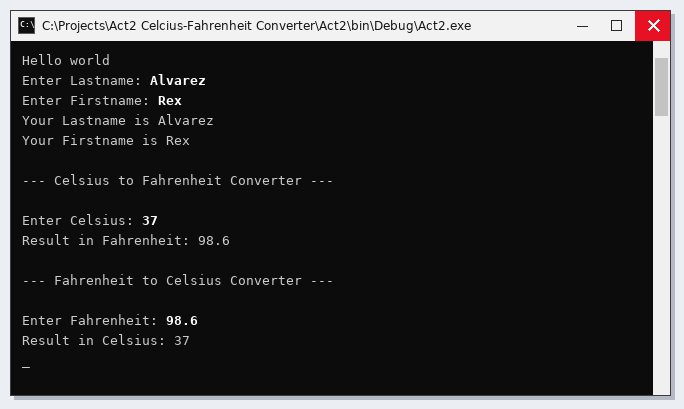

---

# Activity 3 - Activity3_20260629

## Source Code

```vbnet
Module Module1
    Sub Main()

        'Activity3_20260629'
        'Create a vb.net console app that will accept 3 numbers, and display the sum, difference, product, quotient, and ave of the 3 numbers'

        Try
ulit:
            Console.WriteLine("Activity3_20260629")
            Console.WriteLine("Author: Alvarez, Rex")
            Console.WriteLine("Course Year Section: BSIT 3B")

            Console.Write("Enter number 1: ")
            Dim n1 As Integer = Convert.ToInt16(Console.ReadLine())
            Console.Write("Enter number 2: ")
            Dim n2 As Integer = Convert.ToInt16(Console.ReadLine())
            Console.Write("Enter number 3: ")
            Dim n3 As Integer = Convert.ToInt16(Console.ReadLine())

            Console.Write("The sum is: ")
            Dim sum As Double = n1 + n2 + n3
            Console.WriteLine(sum)

            Console.Write("The difference is: ")
            Dim difference As Double = n1 - n2 - n3
            Console.WriteLine(difference)

            Console.Write("The product is: ")
            Dim product As Double = n1 * n2 * n3
            Console.WriteLine(product)

            Console.Write("The quotient is: ")
            Dim quotient As Double = n1 / n2 / n3
            Console.WriteLine(quotient)

            Console.Write("The average is: ")
            Dim ave As Double = sum / 3
            Console.WriteLine(ave)

        Catch ex As FormatException
            Console.WriteLine("Error: " & ex.Message)
            GoTo ulit
        End Try

        Console.ReadKey()

        'Iti nasursurwak ditoy nga taraon ket iti makuna nga "convertion method" iti agduduma nga datatypes.'
        'ken syak ket na gwapo'
    End Sub
End Module
```

## Sample Run

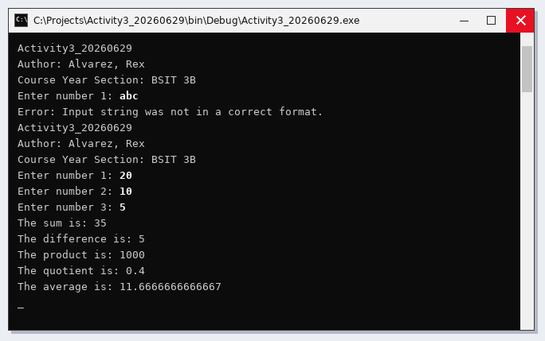

---

# Activity 4 - Activity4_20260703

## Source Code

```vbnet
Public Class Form1

    Private n1 As Integer
    Private n2 As Integer
    Private n3 As Integer
    Private sum As Integer
    Private diff As Integer
    Private quot As Integer
    Private product As Integer
    Private average As Integer

    Private Sub Label2_Click(ByVal sender As System.Object, ByVal e As System.EventArgs) Handles Label2.Click

    End Sub

    Private Sub Form1_Load(ByVal sender As System.Object, ByVal e As System.EventArgs) Handles MyBase.Load

    End Sub

    Private Sub txtn1_TextChanged(ByVal sender As System.Object, ByVal e As System.EventArgs) Handles txtn1.TextChanged

    End Sub

    Private Sub txtn2_TextChanged(ByVal sender As System.Object, ByVal e As System.EventArgs) Handles txtn2.TextChanged

    End Sub

    Private Sub txtn3_TextChanged(ByVal sender As System.Object, ByVal e As System.EventArgs) Handles txtn3.TextChanged

    End Sub

    Private Sub txtsum_TextChanged(ByVal sender As System.Object, ByVal e As System.EventArgs) Handles txtsum.TextChanged

    End Sub

    Private Sub txtdiff_TextChanged(ByVal sender As System.Object, ByVal e As System.EventArgs) Handles txtdiff.TextChanged

    End Sub

    Private Sub txtprod_TextChanged(ByVal sender As System.Object, ByVal e As System.EventArgs) Handles txtprod.TextChanged

    End Sub

    Private Sub txtquot_TextChanged(ByVal sender As System.Object, ByVal e As System.EventArgs) Handles txtquot.TextChanged
        
    End Sub

    Private Sub txtave_TextChanged(ByVal sender As System.Object, ByVal e As System.EventArgs) Handles txtave.TextChanged

    End Sub

    Private Sub btnAdd_Click(ByVal sender As System.Object, ByVal e As System.EventArgs) Handles btnAdd.Click

        Try
            n1 = Convert.ToInt32(txtn1.Text())
            n2 = Convert.ToInt32(txtn2.Text())
            n3 = Convert.ToInt32(txtn3.Text())

            sum = n1 + n2 + n3
            txtsum.Text() = sum.ToString()
            

        Catch ex As Exception
            txtsum.Text = "Error: Maybe Invalid Number..."
        End Try

    End Sub

    Private Sub btnSubtract_Click(ByVal sender As System.Object, ByVal e As System.EventArgs) Handles btnSubtract.Click
        Try
            n1 = Convert.ToInt32(txtn1.Text())
            n2 = Convert.ToInt32(txtn2.Text())
            n3 = Convert.ToInt32(txtn3.Text())

            diff = n1 - n2 - n3
            txtdiff.Text() = diff.ToString()


        Catch ex As Exception
            txtdiff.Text = "Error: Maybe Invalid Number..."
        End Try
    End Sub

    Private Sub btnMultiply_Click(ByVal sender As System.Object, ByVal e As System.EventArgs) Handles btnMultiply.Click
        Try
            n1 = Convert.ToInt32(txtn1.Text())
            n2 = Convert.ToInt32(txtn2.Text())
            n3 = Convert.ToInt32(txtn3.Text())

            quot = n1 * n2 * n3
            txtquot.Text() = quot.ToString()

        Catch ex As Exception
            txtquot.Text = "Error: Maybe Invalid Number..."
        End Try
    End Sub

    Private Sub btnDivide_Click(ByVal sender As System.Object, ByVal e As System.EventArgs) Handles btnDivide.Click
        Try
            n1 = Convert.ToInt32(txtn1.Text())
            n2 = Convert.ToInt32(txtn2.Text())
            n3 = Convert.ToInt32(txtn3.Text())

            product = n1 / n2 / n3
            txtprod.Text() = product.ToString()


        Catch ex As Exception
            txtprod.Text = "Error: Maybe Invalid Number..."
        End Try
    End Sub

    Private Sub btnAverage_Click(ByVal sender As System.Object, ByVal e As System.EventArgs) Handles btnAverage.Click
        Try
            n1 = Convert.ToInt32(txtn1.Text())
            n2 = Convert.ToInt32(txtn2.Text())
            n3 = Convert.ToInt32(txtn3.Text())

            average = (n1 + n2 + n3) / 3
            txtave.Text() = average.ToString()


        Catch ex As Exception
            txtave.Text = "Error: Maybe Invalid Number..."
        End Try
    End Sub

    Private Sub btnClear_Click(ByVal sender As System.Object, ByVal e As System.EventArgs) Handles btnClear.Click
        txtn1.Clear()
        txtn2.Clear()
        txtn3.Clear()
        txtsum.Clear()
        txtdiff.Clear()
        txtprod.Clear()
        txtquot.Clear()
        txtave.Clear()
    End Sub

    Private Sub btnExit_Click(ByVal sender As System.Object, ByVal e As System.EventArgs) Handles btnExit.Click
        Application.Exit()
    End Sub
End Class
```

## Sample Run

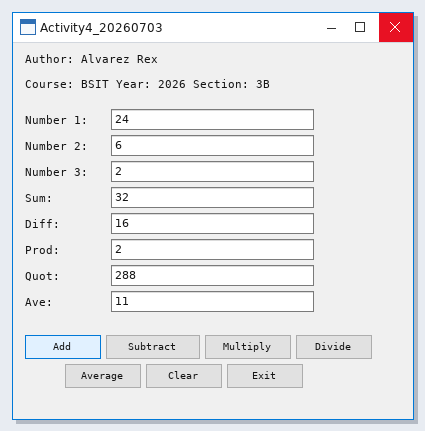

## Form Design

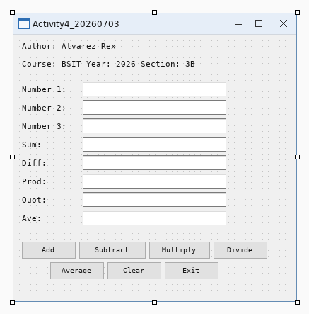

---

# Activity 5

## Source Code

```vbnet
Public Class Form1

    'todo:
    'display passed or failed
    'get the value from the textbox
    Dim ave As Double
    Dim remarks As String

    'try to challenge your self

    Private Sub txtAverage_TextChanged(ByVal sender As System.Object, ByVal e As System.EventArgs) Handles txtAverage.TextChanged

    End Sub

    Private Sub Form1_Load(ByVal sender As System.Object, ByVal e As System.EventArgs) Handles MyBase.Load
        
    End Sub

    Private Sub txtRemarks_TextChanged(ByVal sender As System.Object, ByVal e As System.EventArgs) Handles txtRemarks.TextChanged

    End Sub

    Private Sub btnClear_Click(ByVal sender As System.Object, ByVal e As System.EventArgs) Handles btnClear.Click
        txtAverage.Clear()
        txtRemarks.Clear()
        txtRemarks2.Clear()
        txtRemarks3.Clear()
    End Sub

    Private Sub btnRemarks_Click(ByVal sender As System.Object, ByVal e As System.EventArgs) Handles btnRemarks.Click
        Try
            ave = Convert.ToDouble(txtAverage.Text)

            ' Remarks 1
            txtRemarks.Text = If(ave >= 75, "Passed", If(ave >= 70, "Conditional", "Failed"))

            ' Remarks 2
            txtRemarks2.Text = If(ave >= 94, "A",
                               If(ave >= 89, "B",
                               If(ave >= 84, "C",
                               If(ave >= 80, "D",
                               If(ave >= 75, "E", "F")))))

            ' Remarks 3 
            txtRemarks3.Text = If(ave >= 98, "1.00",
                               If(ave >= 95, "1.25",
                               If(ave >= 92, "1.50",
                               If(ave >= 89, "1.75",
                               If(ave >= 86, "2.00",
                               If(ave >= 83, "2.25",
                               If(ave >= 80, "2.50",
                               If(ave >= 77, "2.75",
                               If(ave >= 75, "3.00",
                               If(ave >= 70, "5.00", "Invalid Grade..."))))))))))

        Catch ex As Exception
            txtRemarks.Text = "There's something wrong with your code.."
            txtRemarks2.Text = "Make sure to enter the right grade number"
            txtRemarks3.Text = "Enter only numbers or decimal numbers"
        End Try

    End Sub

    Private Sub btnExit_Click(ByVal sender As System.Object, ByVal e As System.EventArgs) Handles btnExit.Click
        Application.Exit()
    End Sub

    Private Sub txtRemarks2_TextChanged(ByVal sender As System.Object, ByVal e As System.EventArgs) Handles txtRemarks2.TextChanged

    End Sub

    Private Sub txtRemarks3_TextChanged(ByVal sender As System.Object, ByVal e As System.EventArgs) Handles txtRemarks3.TextChanged

    End Sub
End Class
```

## Sample Run

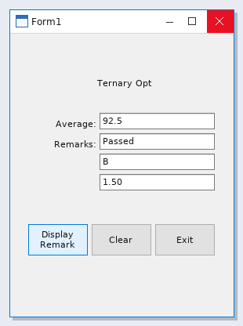

## Form Design

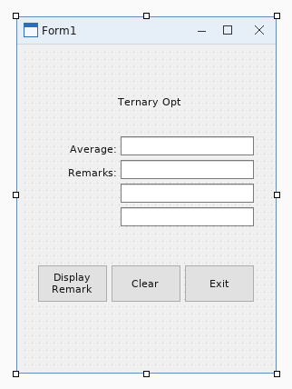

---

# Activity 6 - Act6_IntegProg1_20260715

## Source Code

```vbnet
Public Class Form1

    Dim g1, g2, g3, sum, ave As Integer

    Private Sub Form1_Load(ByVal sender As System.Object, ByVal e As System.EventArgs) Handles MyBase.Load
        
    End Sub

    Private Sub txtG1_TextChanged(ByVal sender As System.Object, ByVal e As System.EventArgs)

    End Sub

    Private Sub txtG2_TextChanged(ByVal sender As System.Object, ByVal e As System.EventArgs)

    End Sub

    Private Sub txtG3_TextChanged(ByVal sender As System.Object, ByVal e As System.EventArgs)

    End Sub

    Private Sub txtAve_TextChanged(ByVal sender As System.Object, ByVal e As System.EventArgs)

    End Sub

    Private Sub txtRemarks1_TextChanged(ByVal sender As System.Object, ByVal e As System.EventArgs)

    End Sub

    Private Sub txtRemarks2_TextChanged(ByVal sender As System.Object, ByVal e As System.EventArgs)

    End Sub

    Private Sub txtRemarks3_TextChanged(ByVal sender As System.Object, ByVal e As System.EventArgs)

    End Sub

    Private Sub btnDisplay_Click(ByVal sender As System.Object, ByVal e As System.EventArgs)

        

    End Sub

    Private Sub btnClear_Click(ByVal sender As System.Object, ByVal e As System.EventArgs)

    End Sub

    Private Sub btnExit_Click(ByVal sender As System.Object, ByVal e As System.EventArgs)
        
    End Sub

    Private Sub btnDisplay_Click_1(ByVal sender As System.Object, ByVal e As System.EventArgs)
        
    End Sub

    Private Sub btnClear_Click_1(ByVal sender As System.Object, ByVal e As System.EventArgs)
        
    End Sub

    Private Sub btnExit_Click_1(ByVal sender As System.Object, ByVal e As System.EventArgs)
        Application.Exit()

    End Sub

    Private Sub btnDisplay_Click_2(ByVal sender As System.Object, ByVal e As System.EventArgs) Handles btnDisplay.Click
        Try

            'convert to double first
            g1 = Convert.ToInt32(txtG1.Text())
            g2 = Convert.ToInt32(txtG2.Text())
            g3 = Convert.ToInt32(txtG3.Text())

            'get the sum and average of the 3 numbers
            sum = g1 + g2 + g3
            ave = sum / 3.0

            'get the value of txtave then convert to string
            txtAve.Text = ave.ToString()

            'decisions
            'remarks 1
            Select Case ave
                Case Is >= 75
                    txtRemarks1.Text = "Passed!"
                Case 74 To 70
                    txtRemarks1.Text = "Conditional!"
                Case Is < 70
                    txtRemarks1.Text = "Failed!"
                Case Else
                    txtRemarks1.Text = "Invalid Grade..."
            End Select

            'remarks 2
            Select Case ave
                Case 95 To 100
                    txtRemarks2.Text = "A"
                Case 89 To 94
                    txtRemarks2.Text = "B"
                Case 80 To 88
                    txtRemarks2.Text = "C"
                Case 75 To 79
                    txtRemarks2.Text = "D"
                Case 70 To 74
                    txtRemarks2.Text = "E"
                Case Is < 70
                    txtRemarks2.Text = "F"
                Case Else
                    txtRemarks2.Text = "Invalid Grade..."
            End Select

            'remarks 3
            Select Case ave
                Case 98 To 100
                    txtRemarks3.Text = "1.00"
                Case 95 To 97
                    txtRemarks3.Text = "1.25"
                Case 92 To 94
                    txtRemarks3.Text = "1.50"
                Case 89 To 91
                    txtRemarks3.Text = "1.75"
                Case 86 To 88
                    txtRemarks3.Text = "2.00"
                Case 83 To 85
                    txtRemarks3.Text = "2.25"
                Case 80 To 82
                    txtRemarks3.Text = "2.50"
                Case 77 To 79
                    txtRemarks3.Text = "2.75"
                Case 75 To 76
                    txtRemarks3.Text = "3.00"
                Case 70 To 74
                    txtRemarks3.Text = "4.00"
                Case Is < 70
                    txtRemarks3.Text = "5.00"
                Case Else
                    txtRemarks3.Text = "Invalid Grade..."
            End Select


            'errror handling
        Catch ex As Exception
            txtRemarks1.Text = "Theres something wrong with your code.."
            txtRemarks2.Text = "Make sure to enter the right grade number"
            txtRemarks3.Text = "Enter only number or decimal number"
        End Try
    End Sub

    Private Sub btnExit_Click_2(ByVal sender As System.Object, ByVal e As System.EventArgs) Handles btnExit.Click
        'exits the application
        Application.Exit()
    End Sub

    Private Sub btnClear_Click_2(ByVal sender As System.Object, ByVal e As System.EventArgs) Handles btnClear.Click
        ' Clear all grade inputs and outputs
        txtG1.Clear()
        txtG2.Clear()
        txtG3.Clear()
        txtAve.Clear()
        txtRemarks1.Clear()
        txtRemarks2.Clear()
        txtRemarks3.Clear()
    End Sub
End Class
```

## Sample Run

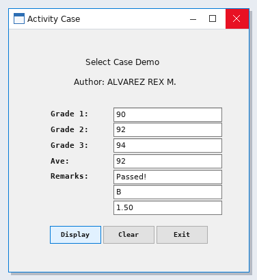

## Form Design

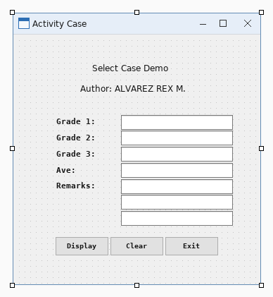

---

# Activity 7 - Act7_IntegProg1_SW20260720

## Source Code

```vbnet
Public Class Form1

    Private Sub calculateButton_Click(ByVal sender As Object,
            ByVal e As EventArgs) Handles calculateButton.Click

        Dim principal As Decimal = Val(principalTextBox.Text)
        Dim rate As Decimal = Val(interestRateTextBox.Text)
        Dim amount As Decimal

        resultsListBox.Items.Add(
            "Year" & vbTab & "Amount on Deposit")

        For yearCounter As Integer = 1 To yearsNumericUpDown.Value
            amount = principal * ((1 + rate / 100) ^ yearCounter)
            resultsListBox.Items.Add(yearCounter & vbTab &
                String.Format("{0:C}", amount))
        Next
    End Sub

    Private Sub principalTextBox_TextChanged(ByVal sender As Object,
            ByVal e As EventArgs) Handles principalTextBox.TextChanged
        resultsListBox.Items.Clear()
    End Sub

    Private Sub interestRateTextBox_TextChanged(ByVal sender As Object,
            ByVal e As EventArgs) Handles interestRateTextBox.TextChanged
        resultsListBox.Items.Clear()
    End Sub

    Private Sub yearsNumericUpDown_ValueChanged(ByVal sender As Object,
            ByVal e As EventArgs) Handles yearsNumericUpDown.ValueChanged
        resultsListBox.Items.Clear()
    End Sub

    Private Sub displaySquareButton_Click(ByVal sender As Object,
            ByVal e As EventArgs) Handles displaySquareButton.Click

        outputTextBox.Clear()

        Dim fillCharacter As String = fillCharacterTextBox.Text
        Dim sideLength As Integer = sideLengthNumericUpDown.Value

        For row As Integer = 1 To sideLength
            For column As Integer = 1 To sideLength
                outputTextBox.AppendText(fillCharacter & " ")
            Next column

            outputTextBox.AppendText(vbCrLf)
        Next row
    End Sub

    Private Sub fillCharacterTextBox_TextChanged(ByVal sender As Object,
            ByVal e As EventArgs) Handles fillCharacterTextBox.TextChanged
        outputTextBox.Clear()
    End Sub

    Private Sub sideLengthNumericUpDown_ValueChanged(ByVal sender As Object,
            ByVal e As EventArgs) Handles sideLengthNumericUpDown.ValueChanged
        outputTextBox.Clear()
    End Sub

    Dim aCount As Integer
    Dim bCount As Integer
    Dim cCount As Integer
    Dim dCount As Integer
    Dim fCount As Integer
    Dim perfectScoreCount As Integer

    Private Sub submitGradeButton_Click(ByVal sender As Object,
            ByVal e As EventArgs) Handles submitGradeButton.Click

        Dim grade As Integer = Val(gradeTextBox.Text)

        gradesListBox.Items.Add(grade)
        gradeTextBox.Clear()

        Select Case grade
            Case 100
                perfectScoreCount += 1
                aCount += 1
            Case 90 To 99
                aCount += 1
            Case 80 To 89
                bCount += 1
            Case 70 To 79
                cCount += 1
            Case 60 To 69
                dCount += 1
            Case Else
                fCount += 1
        End Select

        gradeTextBox.Focus()
    End Sub

    Private Sub calculateAverageButton_Click(ByVal sender As Object,
            ByVal e As EventArgs) Handles calculateAverageButton.Click

        Dim total As Integer
        Dim gradeCounter As Integer
        Dim grade As Integer
        Dim average As Double

        total = 0
        gradeCounter = 0

        Do While gradeCounter < gradesListBox.Items.Count
            grade = gradesListBox.Items(gradeCounter)
            total += grade
            gradeCounter += 1
        Loop

        If gradeCounter <> 0 Then
            average = total / gradeCounter

            classAverageLabel.Text = "Total of the " & gradeCounter &
                " grade(s) is " & total & vbCrLf & "Class average is " &
                String.Format("{0:F}", average) & vbCrLf & vbCrLf

            classAverageLabel.Text &=
                "Letter grade summary:" & vbCrLf & "A: " & aCount &
                vbCrLf & "B: " & bCount & vbCrLf & "C: " & cCount &
                vbCrLf & "D: " & dCount & vbCrLf & "F: " & fCount &
                vbCrLf & "Perfect scores: " & perfectScoreCount
        Else
            classAverageLabel.Text = "No grades were entered"
        End If
    End Sub

    Private Sub clearGradesButton_Click(ByVal sender As Object,
            ByVal e As EventArgs) Handles clearGradesButton.Click

        gradesListBox.Items.Clear()
        classAverageLabel.Text = String.Empty
    End Sub

    Private Sub Form1_Load(ByVal sender As Object,
            ByVal e As EventArgs) Handles MyBase.Load

        decimalOutputTextBox.AppendText("Decimal" & vbTab & "Octal" &
            vbTab & "Hexadecimal" & vbTab & "Binary" & vbCrLf)

        For number As Integer = 1 To 255
            decimalOutputTextBox.AppendText(number & vbTab &
                Convert.ToString(number, 8) & vbTab &
                Convert.ToString(number, 16).ToUpper() & vbTab & vbTab &
                Convert.ToString(number, 2) & vbCrLf)
        Next number
    End Sub

    Private Sub decimalOutputTextBox_TextChanged(ByVal sender As System.Object, ByVal e As System.EventArgs) Handles decimalOutputTextBox.TextChanged

    End Sub

    Private Sub tabClassAverage_Click(ByVal sender As System.Object, ByVal e As System.EventArgs) Handles tabClassAverage.Click

    End Sub

    Private Sub TabPage1_Click(ByVal sender As System.Object, ByVal e As System.EventArgs) Handles TabPage1.Click
        'square, rectangle, trapesoid, triangle, circle
    End Sub

    Private Sub TabPage2_Click(ByVal sender As System.Object, ByVal e As System.EventArgs) Handles TabPage2.Click

    End Sub
End Class
```

## Sample Run

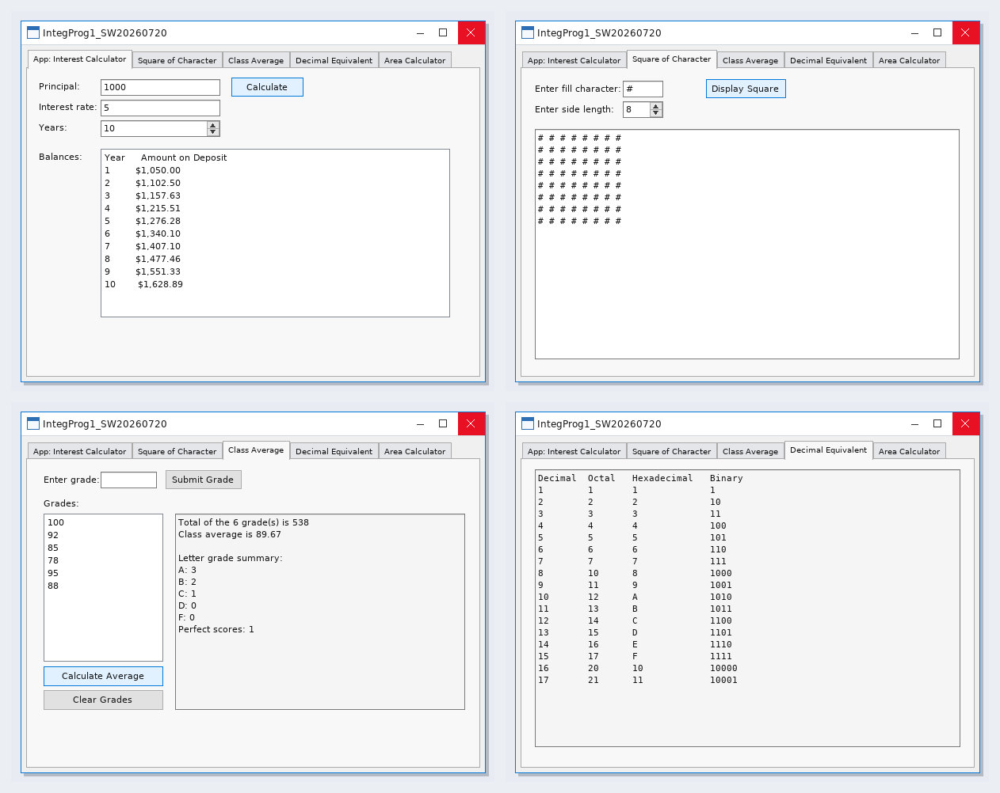

## Form Design

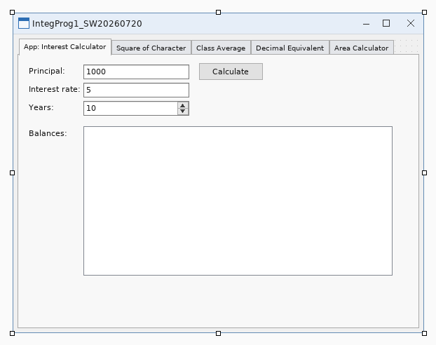

---

# Activity 8 - Act8_SW20260805

## Source Code

```vbnet
Public Class Form1

    Private Sub Form1_Load(ByVal sender As System.Object, ByVal e As System.EventArgs) Handles MyBase.Load

    End Sub

    Private Sub messageInfoGroupBox_Enter(ByVal sender As System.Object, ByVal e As System.EventArgs) Handles messageInfoGroupBox.Enter

    End Sub

    Private Sub titleTextBox_TextChanged(ByVal sender As System.Object, ByVal e As System.EventArgs) Handles titleTextBox.TextChanged

    End Sub

    Private Sub messageTextBox_TextChanged(ByVal sender As System.Object, ByVal e As System.EventArgs) Handles messageTextBox.TextChanged

    End Sub

    Private Sub displayButton_Click(ByVal sender As System.Object, ByVal e As System.EventArgs) Handles displayButton.Click

        Dim messageDescription As String = messageTextBox.Text
        Dim messageTitle As String = titleTextBox.Text

        Dim iconType As MessageBoxIcon
        Dim buttonType As MessageBoxButtons
        Dim defaultButton As MessageBoxDefaultButton

        Dim result As DialogResult

        Try

            If String.IsNullOrWhiteSpace(titleTextBox.Text) Then
                MessageBox.Show("Please enter a title.",
                                "Missing Title",
                                MessageBoxButtons.OK,
                                MessageBoxIcon.Warning)

                titleTextBox.Focus()
                Return
            End If

            If String.IsNullOrWhiteSpace(messageTextBox.Text) Then
                MessageBox.Show("Please enter a message.",
                                "Missing Message",
                                MessageBoxButtons.OK,
                                MessageBoxIcon.Warning)

                messageTextBox.Focus()
                Return
            End If

            If Not informationRadioButton.Checked AndAlso
               Not warningRadioButton.Checked AndAlso
               Not questionRadioButton.Checked AndAlso
               Not criticalRadioButton.Checked Then

                MessageBox.Show("Please select an icon.",
                                "Icon Required",
                                MessageBoxButtons.OK,
                                MessageBoxIcon.Warning)

                Return
            End If

            If Not okRadioButton.Checked AndAlso
               Not okCancelRadioButton.Checked AndAlso
               Not yesNoRadioButton.Checked AndAlso
               Not yesNoCancelRadioButton.Checked AndAlso
               Not retryCancelRadioButton.Checked AndAlso
               Not abortRetryIgnoreRadioButton.Checked Then

                MessageBox.Show("Please select a button type.",
                                "Button Required",
                                MessageBoxButtons.OK,
                                MessageBoxIcon.Warning)

                Return
            End If

            If Not defaultButton1RadioButton.Checked AndAlso
               Not defaultButton2RadioButton.Checked AndAlso
               Not defaultButton3RadioButton.Checked Then

                MessageBox.Show("Please select a default button.",
                                "Default Button Required",
                                MessageBoxButtons.OK,
                                MessageBoxIcon.Warning)

                Return
            End If

            If informationRadioButton.Checked Then
                iconType = MessageBoxIcon.Information

            ElseIf warningRadioButton.Checked Then
                iconType = MessageBoxIcon.Warning

            ElseIf questionRadioButton.Checked Then
                iconType = MessageBoxIcon.Question

            Else
                iconType = MessageBoxIcon.Error
            End If

            If okRadioButton.Checked Then
                buttonType = MessageBoxButtons.OK

            ElseIf okCancelRadioButton.Checked Then
                buttonType = MessageBoxButtons.OKCancel

            ElseIf yesNoRadioButton.Checked Then
                buttonType = MessageBoxButtons.YesNo

            ElseIf yesNoCancelRadioButton.Checked Then
                buttonType = MessageBoxButtons.YesNoCancel

            ElseIf retryCancelRadioButton.Checked Then
                buttonType = MessageBoxButtons.RetryCancel

            Else
                buttonType = MessageBoxButtons.AbortRetryIgnore
            End If

            If defaultButton1RadioButton.Checked Then
                defaultButton = MessageBoxDefaultButton.Button1

            ElseIf defaultButton2RadioButton.Checked Then
                defaultButton = MessageBoxDefaultButton.Button2

            Else
                defaultButton = MessageBoxDefaultButton.Button3
            End If

            result = MessageBox.Show(
                messageDescription,
                messageTitle,
                buttonType,
                iconType,
                defaultButton)

            Select Case result

                Case DialogResult.OK
                    MessageBox.Show("OK has been clicked!",
                                    "Result",
                                    MessageBoxButtons.OK,
                                    MessageBoxIcon.Information)

                Case DialogResult.Cancel
                    MessageBox.Show("Cancel has been clicked!",
                                    "Result",
                                    MessageBoxButtons.OK,
                                    MessageBoxIcon.Information)

                Case DialogResult.Yes
                    MessageBox.Show("Yes has been clicked!",
                                    "Result",
                                    MessageBoxButtons.OK,
                                    MessageBoxIcon.Information)

                Case DialogResult.No
                    MessageBox.Show("No has been clicked!",
                                    "Result",
                                    MessageBoxButtons.OK,
                                    MessageBoxIcon.Information)

                Case DialogResult.Retry
                    MessageBox.Show("Retry has been clicked!",
                                    "Result",
                                    MessageBoxButtons.OK,
                                    MessageBoxIcon.Information)

                Case DialogResult.Abort
                    MessageBox.Show("Abort has been clicked!",
                                    "Result",
                                    MessageBoxButtons.OK,
                                    MessageBoxIcon.Information)

                Case DialogResult.Ignore
                    MessageBox.Show("Ignore has been clicked!",
                                    "Result",
                                    MessageBoxButtons.OK,
                                    MessageBoxIcon.Information)

            End Select

        Catch ex As Exception

            MessageBox.Show(ex.Message,
                            "There is an error",
                            MessageBoxButtons.OK,
                            MessageBoxIcon.Error)

        End Try

    End Sub

    Private Sub clearButton_Click(ByVal sender As System.Object, ByVal e As System.EventArgs) Handles clearButton.Click

        titleTextBox.Clear()
        messageTextBox.Clear()

        informationRadioButton.Checked = False
        warningRadioButton.Checked = False
        questionRadioButton.Checked = False
        criticalRadioButton.Checked = False

        okRadioButton.Checked = False
        okCancelRadioButton.Checked = False
        yesNoRadioButton.Checked = False
        yesNoCancelRadioButton.Checked = False
        retryCancelRadioButton.Checked = False
        abortRetryIgnoreRadioButton.Checked = False

        defaultButton1RadioButton.Checked = False
        defaultButton2RadioButton.Checked = False
        defaultButton3RadioButton.Checked = False

        titleTextBox.Focus()

    End Sub

    Private Sub exitButton_Click(ByVal sender As System.Object, ByVal e As System.EventArgs) Handles exitButton.Click

        Application.Exit()

    End Sub

    Private Sub iconsGroupBox_Enter(ByVal sender As System.Object, ByVal e As System.EventArgs) Handles iconsGroupBox.Enter

    End Sub

    Private Sub informationRadioButton_CheckedChanged(ByVal sender As System.Object, ByVal e As System.EventArgs) Handles informationRadioButton.CheckedChanged

    End Sub

    Private Sub questionRadioButton_CheckedChanged(ByVal sender As System.Object, ByVal e As System.EventArgs) Handles questionRadioButton.CheckedChanged

    End Sub

    Private Sub warningRadioButton_CheckedChanged(ByVal sender As System.Object, ByVal e As System.EventArgs) Handles warningRadioButton.CheckedChanged

    End Sub

    Private Sub criticalRadioButton_CheckedChanged(ByVal sender As System.Object, ByVal e As System.EventArgs) Handles criticalRadioButton.CheckedChanged

    End Sub

    Private Sub buttonsGroupBox_Enter(ByVal sender As System.Object, ByVal e As System.EventArgs) Handles buttonsGroupBox.Enter

    End Sub

    Private Sub okRadioButton_CheckedChanged(ByVal sender As System.Object, ByVal e As System.EventArgs) Handles okRadioButton.CheckedChanged

    End Sub

    Private Sub okCancelRadioButton_CheckedChanged(ByVal sender As System.Object, ByVal e As System.EventArgs) Handles okCancelRadioButton.CheckedChanged

    End Sub

    Private Sub yesNoRadioButton_CheckedChanged(ByVal sender As System.Object, ByVal e As System.EventArgs) Handles yesNoRadioButton.CheckedChanged

    End Sub

    Private Sub yesNoCancelRadioButton_CheckedChanged(ByVal sender As System.Object, ByVal e As System.EventArgs) Handles yesNoCancelRadioButton.CheckedChanged

    End Sub

    Private Sub retryCancelRadioButton_CheckedChanged(ByVal sender As System.Object, ByVal e As System.EventArgs) Handles retryCancelRadioButton.CheckedChanged

    End Sub

    Private Sub abortRetryIgnoreRadioButton_CheckedChanged(ByVal sender As System.Object, ByVal e As System.EventArgs) Handles abortRetryIgnoreRadioButton.CheckedChanged

    End Sub

    Private Sub defaultButtonGroupBox_Enter(ByVal sender As System.Object, ByVal e As System.EventArgs) Handles defaultButtonGroupBox.Enter

    End Sub

    Private Sub defaultButton1RadioButton_CheckedChanged(ByVal sender As System.Object, ByVal e As System.EventArgs) Handles defaultButton1RadioButton.CheckedChanged

    End Sub

    Private Sub defaultButton2RadioButton_CheckedChanged(ByVal sender As System.Object, ByVal e As System.EventArgs) Handles defaultButton2RadioButton.CheckedChanged

    End Sub

    Private Sub defaultButton3RadioButton_CheckedChanged(ByVal sender As System.Object, ByVal e As System.EventArgs) Handles defaultButton3RadioButton.CheckedChanged

    End Sub

End Class
```

## Sample Run

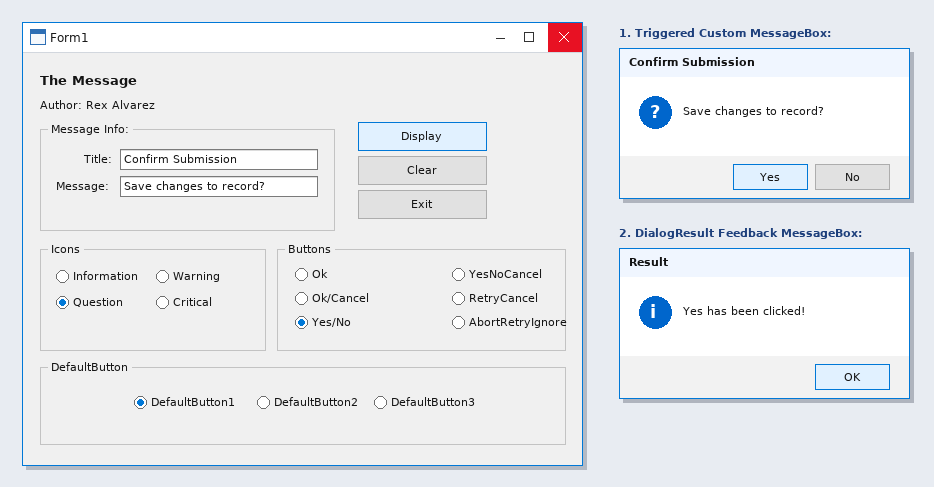

## Form Design

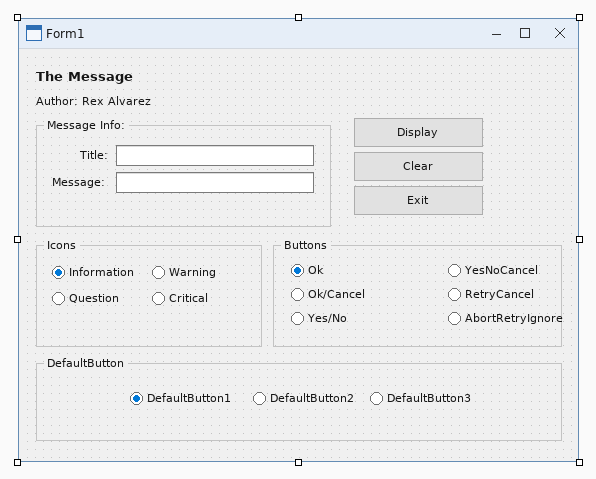

---

# Activity 9 - SW202609301600

## Source Code

```vbnet
Imports System
Imports System.IO
Imports System.Diagnostics
Imports System.Windows.Forms

Public Class ListViewSample
    Private currentFolder As String = Environment.GetFolderPath(Environment.SpecialFolder.MyDocuments)

    Public Sub New()
        InitializeComponent()
        AddHandler menuList.Click, AddressOf OpenListForm
      
        AddHandler menuExit.Click, AddressOf ExitApplication
    End Sub

    Private Sub OpenListForm(ByVal sender As Object, ByVal e As EventArgs)
        Using form As New ListViewSample()
            form.ShowDialog()
        End Using
    End Sub


    Private Sub ExitApplication(ByVal sender As Object, ByVal e As EventArgs)
        Me.Close()
    End Sub

    Private Sub Form1_Load(ByVal sender As Object, ByVal e As EventArgs) Handles MyBase.Load
        LoadFolder(currentFolder)
    End Sub

    Private Sub LoadFolder(ByVal folder As String)
        If Not Directory.Exists(folder) Then Return
        currentFolder = folder
        txtPath.Text = folder
        lv.Items.Clear()
        Try
            For Each directoryName As String In Directory.GetDirectories(folder)
                Dim item As New ListViewItem(Path.GetFileName(directoryName))
                item.SubItems.Add("Folder")
                item.SubItems.Add(Directory.GetLastWriteTime(directoryName).ToString())
                item.Tag = directoryName
                lv.Items.Add(item)
            Next
            For Each fileName As String In Directory.GetFiles(folder)
                Dim info As New FileInfo(fileName)
                Dim item As New ListViewItem(info.Name)
                item.SubItems.Add(info.Extension)
                item.SubItems.Add(info.Length.ToString() & " bytes")
                item.Tag = fileName
                lv.Items.Add(item)
            Next
            lbl.Text = lv.Items.Count.ToString() & " item(s)"
        Catch ex As Exception
            lbl.Text = ex.Message
        End Try
    End Sub

    Private Sub browse_Click(ByVal sender As Object, ByVal e As EventArgs) Handles browse.Click
        Using dialog As New FolderBrowserDialog()
            dialog.SelectedPath = currentFolder
            dialog.Description = "Select a folder"
            If dialog.ShowDialog() = DialogResult.OK Then
                LoadFolder(dialog.SelectedPath)
            End If
        End Using
    End Sub

    Private Sub btnRefresh_Click(ByVal sender As Object, ByVal e As EventArgs) Handles btnRefresh.Click
        LoadFolder(currentFolder)
    End Sub

    Private Sub details_Click(ByVal sender As Object, ByVal e As EventArgs) Handles details.Click
        lv.View = View.Details
    End Sub

    Private Sub list_Click(ByVal sender As Object, ByVal e As EventArgs) Handles list.Click
        lv.View = View.List
    End Sub

    Private Sub lv_DoubleClick(ByVal sender As Object, ByVal e As EventArgs) Handles lv.DoubleClick
        If lv.SelectedItems.Count = 0 Then Return
        Dim selectedPath As String = CStr(lv.SelectedItems(0).Tag)
        If Directory.Exists(selectedPath) Then
            LoadFolder(selectedPath)
        ElseIf File.Exists(selectedPath) Then
            Process.Start(selectedPath)
        End If
    End Sub

    Private Sub lv_ColumnClick(ByVal sender As Object, ByVal e As ColumnClickEventArgs) Handles lv.ColumnClick
        lv.ListViewItemSorter = New ListViewComparer(e.Column)
        lv.Sort()
    End Sub

    Private Class ListViewComparer
        Implements System.Collections.IComparer
        Private ReadOnly columnNumber As Integer

        Public Sub New(ByVal column As Integer)
            columnNumber = column
        End Sub

        Public Function Compare(ByVal first As Object, ByVal second As Object) As Integer Implements System.Collections.IComparer.Compare
            Dim a As ListViewItem = DirectCast(first, ListViewItem)
            Dim b As ListViewItem = DirectCast(second, ListViewItem)
            Return String.Compare(a.SubItems(columnNumber).Text, b.SubItems(columnNumber).Text, True)
        End Function
    End Class
End Class
```

## Sample Run

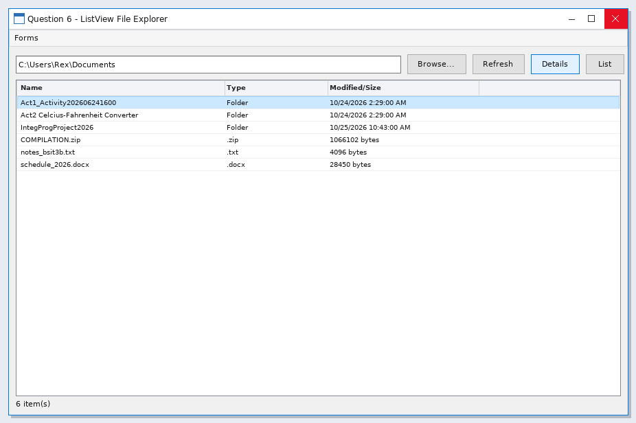

## Form Design

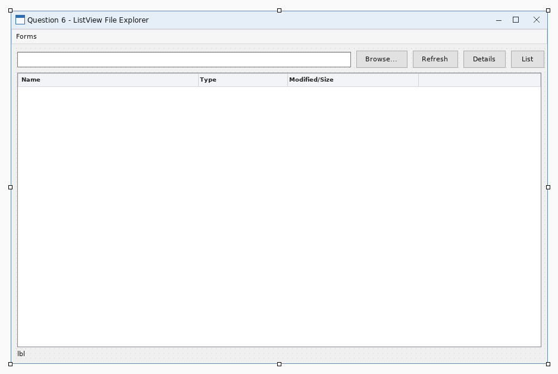

---

# Activity 10 - SW20261002

## Source Code

### `Form1.vb`
```vbnet
Option Strict On
Option Explicit On

Public Class Form1
    Private colorChanged As Boolean = False

    Private Sub menuSplitPanel_Click(ByVal sender As Object, ByVal e As EventArgs) Handles menuSplitPanel.Click
        Dim nextForm As New Form2()
        nextForm.Owner = Me
        AddHandler nextForm.FormClosed, AddressOf SplitFormClosed
        nextForm.Show()
        Me.Hide()
    End Sub

    Private Sub SplitFormClosed(ByVal sender As Object, ByVal e As FormClosedEventArgs)
        If Not Me.IsDisposed Then Me.Show()
    End Sub

    Private Sub menuExit_Click(ByVal sender As Object, ByVal e As EventArgs) Handles menuExit.Click
        Application.Exit()
    End Sub

    Private Sub btnVisible_Click(ByVal sender As Object, ByVal e As EventArgs) Handles btnVisible.Click
        pnlGroup.Visible = Not pnlGroup.Visible
        btnVisible.Text = If(pnlGroup.Visible, "Hide Group", "Show Group")
        lblStatus.Text = "Visible = " & pnlGroup.Visible.ToString()
    End Sub

    Private Sub btnBackColor_Click(ByVal sender As Object, ByVal e As EventArgs) Handles btnBackColor.Click
        colorChanged = Not colorChanged
        pnlNested.BackColor = If(colorChanged, Color.LightSkyBlue, Color.PaleGreen)
        lblStatus.Text = "BackColor changed on the nested panel."
    End Sub

    Private Sub btnBorder_Click(ByVal sender As Object, ByVal e As EventArgs) Handles btnBorder.Click
        If pnlWorkspace.BorderStyle = BorderStyle.Fixed3D Then
            pnlWorkspace.BorderStyle = BorderStyle.FixedSingle
        Else
            pnlWorkspace.BorderStyle = BorderStyle.Fixed3D
        End If
        lblStatus.Text = "BorderStyle = " & pnlWorkspace.BorderStyle.ToString()
    End Sub

    Private Sub btnRefresh_Click(ByVal sender As Object, ByVal e As EventArgs) Handles btnRefresh.Click
        pnlWorkspace.Refresh()
        lblStatus.Text = "Refresh() repainted the workspace panel."
    End Sub

    Private Sub btnInvalidate_Click(ByVal sender As Object, ByVal e As EventArgs) Handles btnInvalidate.Click
        pnlWorkspace.Invalidate(True)
        lblStatus.Text = "Invalidate() requested a redraw of the panel and child controls."
    End Sub

    Private Sub btnFocus_Click(ByVal sender As Object, ByVal e As EventArgs) Handles btnFocus.Click
        Dim result As Boolean = pnlWorkspace.Focus()
        lblStatus.Text = "Focus() result = " & result.ToString()
    End Sub

    Private Sub btnContains_Click(ByVal sender As Object, ByVal e As EventArgs) Handles btnContains.Click
        Dim result As Boolean = pnlWorkspace.Contains(pnlGroup)
        lblStatus.Text = "Contains(pnlGroup) = " & result.ToString()
    End Sub

    Private Sub btnDispose_Click(ByVal sender As Object, ByVal e As EventArgs) Handles btnDispose.Click
        Dim sample As New Panel()
        sample.Controls.Add(New Label())
        sample.Dispose()
        lblStatus.Text = "Dispose() released a temporary panel and its controls."
    End Sub

    Private Sub btnSave_Click(ByVal sender As Object, ByVal e As EventArgs) Handles btnSave.Click
        lblStatus.Text = txtName.Text & " - " & txtCourse.Text & " saved from grouped controls."
    End Sub
End Class
```

### `Form2.vb`
```vbnet
Option Strict On
Option Explicit On

Public Class Form2
    Private locked As Boolean = False

    Private Sub Form2_Load(ByVal sender As Object, ByVal e As EventArgs) Handles MyBase.Load
        SetSafeDistance(splitMain, 210)
        SetSafeDistance(splitInner, CInt(splitInner.Height * 0.62))
        AddRecord("Student Records", "ListView in Panel1")
        AddRecord("Course Information", "Independent content")
        AddRecord("Enrollment Report", "Resizable section")
        AddRecord("System Settings", "Navigation example")
    End Sub

    Private Sub AddRecord(ByVal title As String, ByVal category As String)
        Dim item As New ListViewItem(title)
        item.SubItems.Add(category)
        lvRecords.Items.Add(item)
    End Sub

    Private Sub lvRecords_SelectedIndexChanged(ByVal sender As Object, ByVal e As EventArgs) Handles lvRecords.SelectedIndexChanged
        If lvRecords.SelectedItems.Count = 0 Then Return
        txtDetails.Text = "Selected record: " & lvRecords.SelectedItems(0).Text & vbCrLf & vbCrLf & _
                          "This information is displayed independently inside Panel2." & vbCrLf & vbCrLf & _
                          "Both panels can be resized by dragging the splitter."
    End Sub

    Private Sub menuPanel_Click(ByVal sender As Object, ByVal e As EventArgs) Handles menuPanel.Click
        If Me.Owner IsNot Nothing Then
            Me.Owner.Show()
        Else
            Dim panelForm As New Form1()
            panelForm.Show()
        End If
        Me.Close()
    End Sub

    Private Sub menuExit_Click(ByVal sender As Object, ByVal e As EventArgs) Handles menuExit.Click
        Application.Exit()
    End Sub

    Private Sub btnCollapse1_Click(ByVal sender As Object, ByVal e As EventArgs) Handles btnCollapse1.Click
        CollapsePanel(splitMain, 1)
        lblStatus.Text = "CollapsePanel() collapsed Panel1 of the main SplitContainer."
    End Sub

    Private Sub btnCollapse2_Click(ByVal sender As Object, ByVal e As EventArgs) Handles btnCollapse2.Click
        CollapsePanel(splitInner, 2)
        lblStatus.Text = "CollapsePanel() collapsed Panel2 of the inner SplitContainer."
    End Sub

    Private Sub btnExpand_Click(ByVal sender As Object, ByVal e As EventArgs) Handles btnExpand.Click
        ExpandPanel(splitMain)
        ExpandPanel(splitInner)
        SetSafeDistance(splitMain, 210)
        If splitInner.Orientation = Orientation.Horizontal Then
            SetSafeDistance(splitInner, CInt(splitInner.Height * 0.62))
        Else
            SetSafeDistance(splitInner, CInt(splitInner.Width * 0.62))
        End If
        lblStatus.Text = "ExpandPanel() displayed Panel1 and Panel2."
    End Sub

    Private Sub btnOrientation_Click(ByVal sender As Object, ByVal e As EventArgs) Handles btnOrientation.Click
        Try
            splitInner.Panel1MinSize = 60
            splitInner.Panel2MinSize = 60
            SetSafeDistance(splitInner, 150)
            If splitInner.Orientation = Orientation.Horizontal Then
                splitInner.Orientation = Orientation.Vertical
                splitInner.Panel1MinSize = 180
                splitInner.Panel2MinSize = 160
                SetSafeDistance(splitInner, CInt(splitInner.Width * 0.62))
                lblStatus.Text = "Orientation = Vertical, panels are left and right."
            Else
                splitInner.Orientation = Orientation.Horizontal
                splitInner.Panel1MinSize = 120
                splitInner.Panel2MinSize = 100
                SetSafeDistance(splitInner, CInt(splitInner.Height * 0.62))
                lblStatus.Text = "Orientation = Horizontal, panels are top and bottom."
            End If
        Catch ex As Exception
            lblStatus.Text = ex.Message
        End Try
    End Sub

    Private Sub btnLock_Click(ByVal sender As Object, ByVal e As EventArgs) Handles btnLock.Click
        locked = Not locked
        splitMain.IsSplitterFixed = locked
        splitInner.IsSplitterFixed = locked
        btnLock.Text = If(locked, "Unlock Splitters", "Lock Splitters")
        lblStatus.Text = "IsSplitterFixed = " & locked.ToString()
    End Sub

    Private Sub btnRefresh_Click(ByVal sender As Object, ByVal e As EventArgs) Handles btnRefresh.Click
        splitMain.Refresh()
        splitInner.Refresh()
        lblStatus.Text = "Refresh() repainted both SplitContainer controls."
    End Sub

    Private Sub btnInvalidate_Click(ByVal sender As Object, ByVal e As EventArgs) Handles btnInvalidate.Click
        splitMain.Invalidate(True)
        splitInner.Invalidate(True)
        lblStatus.Text = "Invalidate() requested a redraw of every split panel."
    End Sub

    Private Sub btnDispose_Click(ByVal sender As Object, ByVal e As EventArgs) Handles btnDispose.Click
        Dim sample As New SplitContainer()
        sample.Panel1.Controls.Add(New Label())
        sample.Panel2.Controls.Add(New Button())
        sample.Dispose()
        lblStatus.Text = "Dispose() released a temporary SplitContainer and both panels."
    End Sub

    Private Sub CollapsePanel(ByVal target As SplitContainer, ByVal panelNumber As Integer)
        If panelNumber = 1 Then
            target.Panel1Collapsed = True
        Else
            target.Panel2Collapsed = True
        End If
    End Sub

    Private Sub ExpandPanel(ByVal target As SplitContainer)
        target.Panel1Collapsed = False
        target.Panel2Collapsed = False
    End Sub

    Private Sub SetSafeDistance(ByVal target As SplitContainer, ByVal requested As Integer)
        Dim available As Integer
        If target.Orientation = Orientation.Vertical Then
            available = target.ClientSize.Width
        Else
            available = target.ClientSize.Height
        End If
        Dim minimum As Integer = target.Panel1MinSize
        Dim maximum As Integer = available - target.Panel2MinSize - target.SplitterWidth
        If maximum >= minimum Then target.SplitterDistance = Math.Max(minimum, Math.Min(requested, maximum))
    End Sub

    Private Sub splitMain_SplitterMoved(ByVal sender As Object, ByVal e As SplitterEventArgs) Handles splitMain.SplitterMoved
        lblStatus.Text = "Main SplitterDistance = " & splitMain.SplitterDistance.ToString()
    End Sub

    Private Sub splitInner_SplitterMoved(ByVal sender As Object, ByVal e As SplitterEventArgs) Handles splitInner.SplitterMoved
        lblStatus.Text = "Inner SplitterDistance = " & splitInner.SplitterDistance.ToString()
    End Sub
End Class
```

## Sample Run

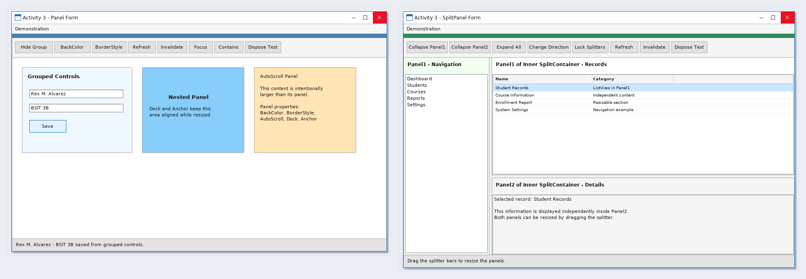

## Form Design

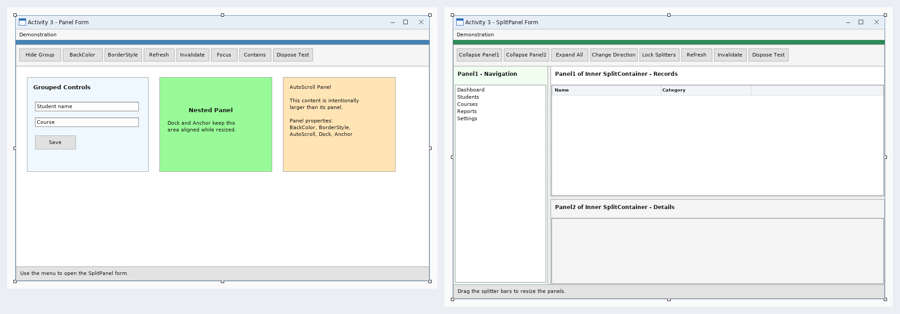

---

# Activity 11 - SW202610021600

## Source Code

### `MenuForm.vb`
```vbnet
Imports System
Imports System.Drawing
Imports System.Windows.Forms

Public Class MenuForm
    Inherits Form

    Private menuStrip1 As MenuStrip
    Private listMenu As ToolStripMenuItem
    Private treeMenu As ToolStripMenuItem
    Private openMenu As ToolStripMenuItem
    Private combinedMenu As ToolStripMenuItem
    Private exitMenu As ToolStripMenuItem

    Public Sub New()
        Me.Text = "SW202610021600"
        Me.StartPosition = FormStartPosition.CenterScreen
        Me.Size = New Size(720, 400)
        menuStrip1 = New MenuStrip()
        treeMenu = New ToolStripMenuItem("TreeView File Explorer")
        openMenu = New ToolStripMenuItem("OpenFileDialog File Explorer")
        combinedMenu = New ToolStripMenuItem("Combined File Explorer")
        exitMenu = New ToolStripMenuItem("Exit")
        menuStrip1.Items.AddRange(New ToolStripItem() {treeMenu, openMenu, combinedMenu, exitMenu})
        menuStrip1.Dock = DockStyle.Top
        Me.Controls.Add(menuStrip1)
        Me.MainMenuStrip = menuStrip1

        AddHandler treeMenu.Click, AddressOf OpenTree
        AddHandler openMenu.Click, AddressOf OpenDialog
        AddHandler combinedMenu.Click, AddressOf OpenCombined
        AddHandler exitMenu.Click, AddressOf ExitProgram
    End Sub


    Private Sub OpenTree(ByVal sender As Object, ByVal e As EventArgs)
        Using form As New TreeViewSample()
            form.ShowDialog()
        End Using
    End Sub

    Private Sub OpenDialog(ByVal sender As Object, ByVal e As EventArgs)
        Using form As New OpenFileDialogSample()
            form.ShowDialog()
        End Using
    End Sub

    Private Sub OpenCombined(ByVal sender As Object, ByVal e As EventArgs)
        Using form As New CombinedSample()
            form.ShowDialog()
        End Using
    End Sub

    Private Sub ExitProgram(ByVal sender As Object, ByVal e As EventArgs)
        Me.Close()
    End Sub
Private Sub MenuForm_Load(ByVal sender As System.Object, ByVal e As System.EventArgs) Handles MyBase.Load

    End Sub
End Class
```

### `TreeViewSample.vb`
```vbnet
Imports System
Imports System.IO
Imports System.Windows.Forms

Public Class TreeViewSample
    Public Sub New()
        InitializeComponent()
    End Sub
    Private Sub Form1_Load(ByVal sender As Object, ByVal e As EventArgs) Handles MyBase.Load
        BuildTree()
    End Sub
    Private Sub BuildTree()
        tree.Nodes.Clear()
        For Each drive As DriveInfo In DriveInfo.GetDrives()
            If drive.IsReady Then
                Dim node As New TreeNode(drive.Name)
                node.Tag = drive.RootDirectory.FullName
                node.Nodes.Add("Loading...")
                tree.Nodes.Add(node)
            End If
        Next
    End Sub
    Private Sub tree_BeforeExpand(ByVal sender As Object, ByVal e As TreeViewCancelEventArgs) Handles tree.BeforeExpand
        Dim folder As String = CStr(e.Node.Tag)
        e.Node.Nodes.Clear()
        Try
            For Each directoryName As String In Directory.GetDirectories(folder)
                Dim child As New TreeNode(Path.GetFileName(directoryName))
                child.Tag = directoryName
                Try
                    If Directory.GetDirectories(directoryName).Length > 0 Then child.Nodes.Add("Loading...")
                Catch
                End Try
                e.Node.Nodes.Add(child)
            Next
        Catch
        End Try
    End Sub
    Private Sub tree_AfterSelect(ByVal sender As Object, ByVal e As TreeViewEventArgs) Handles tree.AfterSelect
        selectedPath.Text = CStr(e.Node.Tag)
    End Sub
    Private Sub btnRefresh_Click(ByVal sender As Object, ByVal e As EventArgs) Handles btnRefresh.Click
        BuildTree()
    End Sub
End Class
```

### `OpenFileDialogSample.vb`
```vbnet
Imports System
Imports System.Windows.Forms

Public Class OpenFileDialogSample
    Public Sub New()
        InitializeComponent()
    End Sub
    Private Sub one_Click(ByVal sender As Object, ByVal e As EventArgs) Handles one.Click
        Using dialog As New OpenFileDialog()
            Configure(dialog, False)
            If dialog.ShowDialog() = DialogResult.OK Then ShowFiles(dialog.FileNames)
        End Using
    End Sub
    Private Sub many_Click(ByVal sender As Object, ByVal e As EventArgs) Handles many.Click
        Using dialog As New OpenFileDialog()
            Configure(dialog, True)
            If dialog.ShowDialog() = DialogResult.OK Then ShowFiles(dialog.FileNames)
        End Using
    End Sub
    Private Sub Configure(ByVal dialog As OpenFileDialog, ByVal allowMultiple As Boolean)
        dialog.Title = "Select file"
        dialog.Filter = "All files (*.*)|*.*|Text files (*.txt)|*.txt|Images (*.jpg;*.png)|*.jpg;*.png"
        dialog.FilterIndex = 1
        dialog.Multiselect = allowMultiple
        dialog.CheckFileExists = True
        dialog.CheckPathExists = True
        dialog.RestoreDirectory = True
    End Sub
    Private Sub ShowFiles(ByVal files() As String)
        selected.Items.Clear()
        For Each fileName As String In files
            selected.Items.Add(fileName)
        Next
    End Sub
    Private Sub clear_Click(ByVal sender As Object, ByVal e As EventArgs) Handles clear.Click
        selected.Items.Clear()
    End Sub
End Class
```

### `CombinedSample.vb`
```vbnet
Imports System
Imports System.IO
Imports System.Diagnostics
Imports System.Windows.Forms

Public Class CombinedSample
    Private currentFolder As String = Environment.GetFolderPath(Environment.SpecialFolder.MyDocuments)
    Public Sub New()
        InitializeComponent()
    End Sub
    Private Sub Form1_Load(ByVal sender As Object, ByVal e As EventArgs) Handles MyBase.Load
        BuildTree()
        LoadFolder(currentFolder)
    End Sub
    Private Sub BuildTree()
        tree.Nodes.Clear()
        For Each drive As DriveInfo In DriveInfo.GetDrives()
            If drive.IsReady Then
                Dim node As New TreeNode(drive.Name)
                node.Tag = drive.RootDirectory.FullName
                node.Nodes.Add("Loading...")
                tree.Nodes.Add(node)
            End If
        Next
    End Sub
    Private Sub tree_BeforeExpand(ByVal sender As Object, ByVal e As TreeViewCancelEventArgs) Handles tree.BeforeExpand
        Dim folder As String = CStr(e.Node.Tag)
        e.Node.Nodes.Clear()
        Try
            For Each directoryName As String In Directory.GetDirectories(folder)
                Dim child As New TreeNode(Path.GetFileName(directoryName))
                child.Tag = directoryName
                e.Node.Nodes.Add(child)
            Next
        Catch
        End Try
    End Sub
    Private Sub tree_AfterSelect(ByVal sender As Object, ByVal e As TreeViewEventArgs) Handles tree.AfterSelect
        currentFolder = CStr(e.Node.Tag)
        LoadFolder(currentFolder)
    End Sub
    Private Sub LoadFolder(ByVal folder As String)
        If Not Directory.Exists(folder) Then Return
        lv.Items.Clear()
        Try
            For Each directoryName As String In Directory.GetDirectories(folder)
                Dim item As New ListViewItem(Path.GetFileName(directoryName))
                item.SubItems.Add("Folder")
                item.Tag = directoryName
                lv.Items.Add(item)
            Next
            For Each fileName As String In Directory.GetFiles(folder)
                Dim item As New ListViewItem(Path.GetFileName(fileName))
                item.SubItems.Add("File")
                item.Tag = fileName
                lv.Items.Add(item)
            Next
        Catch
        End Try
    End Sub
    Private Sub open_Click(ByVal sender As Object, ByVal e As EventArgs) Handles open.Click
        Using dialog As New OpenFileDialog()
            dialog.Filter = "All files (*.*)|*.*"
            dialog.CheckFileExists = True
            If dialog.ShowDialog() = DialogResult.OK Then Process.Start(dialog.FileName)
        End Using
    End Sub
    Private Sub save_Click(ByVal sender As Object, ByVal e As EventArgs) Handles save.Click
        Using dialog As New SaveFileDialog()
            dialog.Filter = "Text files (*.txt)|*.txt|All files (*.*)|*.*"
            If dialog.ShowDialog() = DialogResult.OK Then
                Using writer As New StreamWriter(dialog.FileName)
                    For Each item As ListViewItem In lv.Items
                        writer.WriteLine(item.Text & Microsoft.VisualBasic.ControlChars.Tab & item.SubItems(1).Text)
                    Next
                End Using
            End If
        End Using
    End Sub
    Private Sub btnRefresh_Click(ByVal sender As Object, ByVal e As EventArgs) Handles btnRefresh.Click
        BuildTree()
        LoadFolder(currentFolder)
    End Sub
End Class
```

## Sample Run

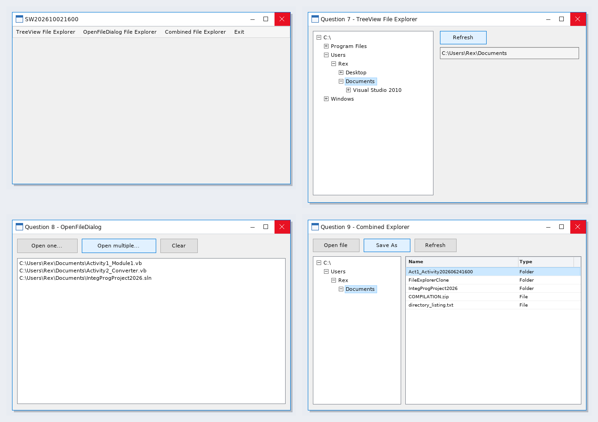

## Form Design

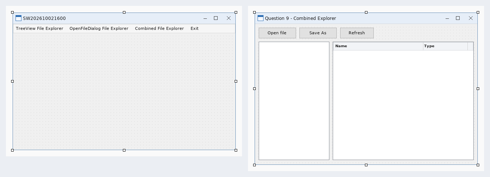

---

# Activity 12

## Source Code

### `Form1.vb`
```vbnet
Option Strict On
Option Explicit On

Imports System.IO
Imports System.Text

Public Class Form1
    Private currentPath As String = ""
    Private history As New List(Of String)()
    Private historyPosition As Integer = -1
    Private changingFolder As Boolean = False
    Private splittersLocked As Boolean = False
    Private previewHost As Panel
    Private cutPaths As New List(Of String)()

    Private Sub Form1_Load(ByVal sender As Object, ByVal e As EventArgs) Handles MyBase.Load
        Try
            txtSearch.Text = ""
            cboShowMode.Items.Clear()
            cboShowMode.Items.Add("Details")
            cboShowMode.Items.Add("Preview")
            cboShowMode.Items.Add("Details + Preview")
            cboShowMode.SelectedIndex = 2
            SetSafeSplitterDistance(splitMain, 220)
            SetSafeSplitterDistance(splitContent, CInt(splitContent.Width * 0.64))
            LoadFolderTree()
            Dim startFolder As String = Environment.GetFolderPath(Environment.SpecialFolder.MyDocuments)
            If Not Directory.Exists(startFolder) Then startFolder = Environment.GetFolderPath(Environment.SpecialFolder.Desktop)
            If Not Directory.Exists(startFolder) Then startFolder = Environment.CurrentDirectory
            NavigateTo(startFolder, True)
            UpdateFileToolState()
        Catch ex As Exception
            lblStatus.Text = "The explorer could not finish loading: " & ex.Message
        End Try
    End Sub

    Private Sub LoadFolderTree()
        tvFolders.Nodes.Clear()
        AddRootNode("Desktop", Environment.GetFolderPath(Environment.SpecialFolder.Desktop))
        AddRootNode("Documents", Environment.GetFolderPath(Environment.SpecialFolder.MyDocuments))
        AddRootNode("Pictures", Environment.GetFolderPath(Environment.SpecialFolder.MyPictures))
        AddRootNode("Computer", "")
        Dim computer As TreeNode = tvFolders.Nodes(tvFolders.Nodes.Count - 1)
        For Each drive As DriveInfo In DriveInfo.GetDrives()
            Dim node As New TreeNode(drive.Name)
            node.Tag = drive.RootDirectory.FullName
            node.Nodes.Add(New TreeNode("Loading"))
            computer.Nodes.Add(node)
        Next
        computer.Expand()
    End Sub

    Private Sub AddRootNode(ByVal title As String, ByVal folderPath As String)
        If folderPath = "" OrElse Not Directory.Exists(folderPath) Then Return
        Dim node As New TreeNode(title)
        node.Tag = folderPath
        node.Nodes.Add(New TreeNode("Loading"))
        tvFolders.Nodes.Add(node)
    End Sub

    Private Sub tvFolders_BeforeExpand(ByVal sender As Object, ByVal e As TreeViewCancelEventArgs) Handles tvFolders.BeforeExpand
        If e.Node.Tag Is Nothing Then Return
        If e.Node.Nodes.Count = 1 AndAlso e.Node.Nodes(0).Tag Is Nothing Then
            e.Node.Nodes.Clear()
            Try
                For Each folder As String In Directory.GetDirectories(CStr(e.Node.Tag))
                    Dim info As New DirectoryInfo(folder)
                    If (info.Attributes And FileAttributes.Hidden) = 0 Then
                        Dim child As New TreeNode(info.Name)
                        child.Tag = info.FullName
                        child.Nodes.Add(New TreeNode("Loading"))
                        e.Node.Nodes.Add(child)
                    End If
                Next
            Catch
            End Try
        End If
    End Sub

    Private Sub tvFolders_AfterSelect(ByVal sender As Object, ByVal e As TreeViewEventArgs) Handles tvFolders.AfterSelect
        If changingFolder OrElse e.Node.Tag Is Nothing Then Return
        NavigateTo(CStr(e.Node.Tag), True)
    End Sub

    Private Sub NavigateTo(ByVal folderPath As String, ByVal addToHistory As Boolean)
        If folderPath = "" OrElse Not Directory.Exists(folderPath) Then
            lblStatus.Text = "Folder not found."
            Return
        End If
        Try
            currentPath = folderPath
            txtAddress.Text = folderPath
            lblFiles.Text = IO.Path.GetFileName(folderPath)
            If lblFiles.Text = "" Then lblFiles.Text = folderPath
            If addToHistory Then
                If historyPosition < history.Count - 1 Then
                    history.RemoveRange(historyPosition + 1, history.Count - historyPosition - 1)
                End If
                If history.Count = 0 OrElse history(history.Count - 1) <> folderPath Then
                    history.Add(folderPath)
                    historyPosition = history.Count - 1
                End If
            End If
            FillFileList(txtSearch.Text.Trim())
            SelectTreePath(folderPath)
            ClearPreview("Select a file or folder to preview it.")
        Catch ex As Exception
            lblStatus.Text = ex.Message
        End Try
    End Sub

    Private Sub SelectTreePath(ByVal folderPath As String)
        changingFolder = True
        Try
            Dim found As TreeNode = FindNode(tvFolders.Nodes, folderPath)
            If found IsNot Nothing Then tvFolders.SelectedNode = found
        Finally
            changingFolder = False
        End Try
    End Sub

    Private Function FindNode(ByVal nodes As TreeNodeCollection, ByVal folderPath As String) As TreeNode
        For Each node As TreeNode In nodes
            If node.Tag IsNot Nothing AndAlso String.Equals(CStr(node.Tag), folderPath, StringComparison.OrdinalIgnoreCase) Then Return node
            If node.IsExpanded Then
                Dim found As TreeNode = FindNode(node.Nodes, folderPath)
                If found IsNot Nothing Then Return found
            End If
        Next
        Return Nothing
    End Function

    Private Sub FillFileList(ByVal filter As String)
        lvFiles.BeginUpdate()
        lvFiles.Items.Clear()
        Try
            For Each folder As String In Directory.GetDirectories(currentPath)
                Dim info As New DirectoryInfo(folder)
                If (info.Attributes And FileAttributes.Hidden) = 0 AndAlso MatchesFilter(info.Name, filter) Then
                    Dim item As New ListViewItem(info.Name)
                    item.SubItems.Add("File folder")
                    item.SubItems.Add("")
                    item.SubItems.Add(info.LastWriteTime.ToString("g"))
                    item.Tag = info.FullName
                    lvFiles.Items.Add(item)
                End If
            Next
            For Each fileName As String In Directory.GetFiles(currentPath)
                Dim info As New FileInfo(fileName)
                If MatchesFilter(info.Name, filter) Then
                    Dim item As New ListViewItem(info.Name)
                    Dim extension As String = info.Extension.ToUpperInvariant()
                    If extension = "" Then extension = "File"
                    item.SubItems.Add(extension & " file")
                    item.SubItems.Add(FormatSize(info.Length))
                    item.SubItems.Add(info.LastWriteTime.ToString("g"))
                    item.Tag = info.FullName
                    lvFiles.Items.Add(item)
                End If
            Next
            lblStatus.Text = lvFiles.Items.Count.ToString() & " items   |   " & currentPath
        Catch ex As Exception
            lblStatus.Text = "Cannot open folder: " & ex.Message
        Finally
            lvFiles.EndUpdate()
        End Try
    End Sub

    Private Function MatchesFilter(ByVal itemName As String, ByVal filter As String) As Boolean
        If filter = "" Then Return True
        Return itemName.IndexOf(filter, StringComparison.OrdinalIgnoreCase) >= 0
    End Function

    Private Function FormatSize(ByVal value As Long) As String
        If value >= 1073741824 Then Return (value / 1073741824.0).ToString("0.00") & " GB"
        If value >= 1048576 Then Return (value / 1048576.0).ToString("0.00") & " MB"
        If value >= 1024 Then Return (value / 1024.0).ToString("0.00") & " KB"
        Return value.ToString() & " bytes"
    End Function

    Private Sub lvFiles_SelectedIndexChanged(ByVal sender As Object, ByVal e As EventArgs) Handles lvFiles.SelectedIndexChanged
        UpdateFileToolState()
        If lvFiles.SelectedItems.Count = 0 Then
            ClearPreview("Select a file or folder to preview it.")
            Return
        End If
        ShowPreview(CStr(lvFiles.SelectedItems(0).Tag))
    End Sub

    Private Sub lvFiles_DoubleClick(ByVal sender As Object, ByVal e As EventArgs) Handles lvFiles.DoubleClick
        If lvFiles.SelectedItems.Count = 0 Then Return
        Dim selectedPath As String = CStr(lvFiles.SelectedItems(0).Tag)
        If Directory.Exists(selectedPath) Then
            NavigateTo(selectedPath, True)
        Else
            Try
                Process.Start(selectedPath)
            Catch ex As Exception
                lblStatus.Text = ex.Message
            End Try
        End If
    End Sub

    Private Sub ShowPreview(ByVal selectedPath As String)
        ClearPreview("")
        previewHost = New Panel()
        previewHost.Dock = DockStyle.Fill
        previewHost.AutoScroll = True
        previewHost.BackColor = Color.White
        previewHost.TabStop = True
        pnlPreviewContent.Controls.Add(previewHost)
        lblPreviewTitle.Text = IO.Path.GetFileName(selectedPath)

        If Directory.Exists(selectedPath) Then
            Try
                Dim info As New DirectoryInfo(selectedPath)
                Dim folderCount As Integer = 0
                Dim fileCount As Integer = 0
                Try
                    folderCount = Directory.GetDirectories(selectedPath).Length
                    fileCount = Directory.GetFiles(selectedPath).Length
                Catch
                End Try
                Dim parentLocation As String = info.FullName
                If info.Parent IsNot Nothing Then parentLocation = info.Parent.FullName
                txtPreviewDetails.Text = "Type: File folder" & vbCrLf & _
                                         "Location: " & parentLocation & vbCrLf & _
                                         "Modified: " & info.LastWriteTime.ToString("g") & vbCrLf & _
                                         "Contains: " & folderCount.ToString() & " folders, " & fileCount.ToString() & " files"
                Dim text As New StringBuilder()
                text.AppendLine(info.FullName)
                text.AppendLine()
                Try
                    For Each folder As String In Directory.GetDirectories(selectedPath)
                        text.AppendLine("[Folder]  " & IO.Path.GetFileName(folder))
                        If text.Length > 100000 Then Exit For
                    Next
                    For Each fileName As String In Directory.GetFiles(selectedPath)
                        Dim child As New FileInfo(fileName)
                        text.AppendLine("          " & child.Name & "   " & FormatSize(child.Length))
                        If text.Length > 200000 Then Exit For
                    Next
                Catch ex As Exception
                    text.AppendLine(ex.Message)
                End Try
                AddTextPreview(text.ToString(), False)
            Catch ex As Exception
                AddTextPreview("Folder preview is not available." & vbCrLf & ex.Message, True)
            End Try
            Return
        End If

        Try
            If Not File.Exists(selectedPath) Then
                ClearPreview("The selected file no longer exists.")
                Return
            End If

            Dim info As New FileInfo(selectedPath)
            Dim extension As String = info.Extension.ToLowerInvariant()
            txtPreviewDetails.Text = "Type: " & If(extension = "", "File", extension.ToUpperInvariant() & " file") & vbCrLf & _
                                     "Size: " & FormatSize(info.Length) & vbCrLf & _
                                     "Created: " & info.CreationTime.ToString("g") & vbCrLf & _
                                     "Modified: " & info.LastWriteTime.ToString("g") & vbCrLf & _
                                     "Attributes: " & info.Attributes.ToString()

            Select Case extension
                Case ".jpg", ".jpeg", ".png", ".gif", ".bmp", ".ico", ".tif", ".tiff", ".wmf", ".emf"
                    If info.Length > 52428800 Then
                        AddTextPreview("This image is larger than 50 MB. Open it normally to avoid using too much memory.", True)
                        Return
                    End If
                    Dim data As Byte() = File.ReadAllBytes(selectedPath)
                    Using stream As New MemoryStream(data)
                        Using source As Image = Image.FromStream(stream)
                            Dim picture As New PictureBox()
                            picture.Dock = DockStyle.Fill
                            picture.SizeMode = PictureBoxSizeMode.Zoom
                            picture.Image = New Bitmap(source)
                            previewHost.Controls.Add(picture)
                            txtPreviewDetails.Text &= vbCrLf & "Dimensions: " & source.Width.ToString() & " x " & source.Height.ToString()
                        End Using
                    End Using

                Case ".rtf"
                    AddRtfPreview(selectedPath)

                Case ".htm", ".html", ".mht", ".mhtml", ".xhtml", ".svg"
                    AddWebPreview(selectedPath)

                Case ".pdf"
                    AddTextPreview(PreviewEngine.GetPdfText(selectedPath), True)

                Case ".docx", ".docm", ".dotx"
                    AddTextPreview(PreviewEngine.GetDocxText(selectedPath), True)

                Case ".xlsx", ".xltx"
                    AddTextPreview(PreviewEngine.GetXlsxText(selectedPath), False)

                Case ".pptx", ".ppsx", ".potx"
                    AddTextPreview(PreviewEngine.GetPptxText(selectedPath), True)

                Case ".doc", ".dot", ".xls", ".xlsm", ".xlsb", ".ppt", ".pps"
                    Dim officeText As String = PreviewEngine.GetLegacyOfficeText(selectedPath)
                    If String.IsNullOrEmpty(officeText) Then
                        officeText = "Microsoft Office is not available for a full preview." & vbCrLf & vbCrLf & PreviewEngine.ScrapeText(selectedPath, 1048576)
                    End If
                    AddTextPreview(officeText, True)

                Case ".csv"
                    AddTextPreview(PreviewEngine.FormatDelimited(ReadText(selectedPath), ","c), False)

                Case ".tsv"
                    AddTextPreview(PreviewEngine.FormatDelimited(ReadText(selectedPath), CChar(vbTab)), False)

                Case ".zip", ".jar", ".apk", ".vsix", ".nupkg", ".epub"
                    AddTextPreview(PreviewEngine.GetZipListing(selectedPath), False)

                Case ".exe", ".dll", ".ocx", ".sys"
                    AddTextPreview(PreviewEngine.GetVersionText(selectedPath) & vbCrLf & GetHexPreview(selectedPath, 512), False)

                Case ".mp3", ".wav", ".wma", ".m4a", ".flac", ".ogg", ".aac", ".mp4", ".avi", ".mkv", ".wmv", ".mov", ".flv", ".3gp", ".webm"
                    AddTextPreview(PreviewEngine.GetMediaText(selectedPath), True)

                Case ".txt", ".log", ".ini", ".xml", ".vb", ".cs", ".cpp", ".c", ".h", ".json", ".sql", ".bat", ".cmd", ".ps1", ".py", ".java", ".js", ".css", ".config", ".md"
                    AddTextPreview(ReadText(selectedPath), False)

                Case Else
                    If LooksLikeText(selectedPath) Then
                        AddTextPreview(ReadText(selectedPath), False)
                    Else
                        AddTextPreview("This format has no visual preview. The first bytes are shown below." & vbCrLf & vbCrLf & GetHexPreview(selectedPath, 2048), False)
                    End If
            End Select

            previewHost.Focus()
            pnlPreviewContent.Refresh()
        Catch ex As OutOfMemoryException
            AddTextPreview("The file is too large or damaged to preview safely.", True)
        Catch ex As UnauthorizedAccessException
            AddTextPreview("Access to this file was denied.", True)
        Catch ex As IOException
            AddTextPreview("The file is unavailable or is being used by another program." & vbCrLf & ex.Message, True)
        Catch ex As Exception
            AddTextPreview("Preview is not available." & vbCrLf & vbCrLf & ex.Message, True)
        End Try
    End Sub

    Private Sub AddRtfPreview(ByVal fileName As String)
        Dim box As New RichTextBox()
        box.BackColor = Color.White
        box.BorderStyle = BorderStyle.None
        box.Dock = DockStyle.Fill
        box.ReadOnly = True
        box.ScrollBars = RichTextBoxScrollBars.Both
        box.LoadFile(fileName)
        previewHost.Controls.Add(box)
    End Sub

    Private Sub AddWebPreview(ByVal fileName As String)
        Dim browser As New WebBrowser()
        browser.AllowWebBrowserDrop = False
        browser.Dock = DockStyle.Fill
        browser.IsWebBrowserContextMenuEnabled = False
        browser.ScriptErrorsSuppressed = True
        previewHost.Controls.Add(browser)
        browser.Navigate(New Uri(fileName))
    End Sub

    Private Function LooksLikeText(ByVal fileName As String) As Boolean
        Try
            Using stream As New FileStream(fileName, FileMode.Open, FileAccess.Read, FileShare.ReadWrite)
                Dim size As Integer = CInt(Math.Min(stream.Length, 1024))
                If size = 0 Then Return True
                Dim data(size - 1) As Byte
                stream.Read(data, 0, size)
                Dim unusual As Integer = 0
                For Each value As Byte In data
                    If value = 0 Then Return False
                    If value < 9 OrElse (value > 13 AndAlso value < 32) Then unusual += 1
                Next
                Return unusual * 100 \ size < 5
            End Using
        Catch
            Return False
        End Try
    End Function

    Private Function GetHexPreview(ByVal fileName As String, ByVal maximum As Integer) As String
        Dim data() As Byte
        Using stream As New FileStream(fileName, FileMode.Open, FileAccess.Read, FileShare.ReadWrite)
            Dim size As Integer = CInt(Math.Min(stream.Length, maximum))
            If size = 0 Then Return "Empty file"
            ReDim data(size - 1)
            stream.Read(data, 0, size)
        End Using
        Dim result As New StringBuilder()
        Dim offset As Integer = 0
        While offset < data.Length
            Dim hexText As New StringBuilder()
            Dim normalText As New StringBuilder()
            For column As Integer = 0 To 15
                If offset + column < data.Length Then
                    Dim value As Byte = data(offset + column)
                    hexText.Append(value.ToString("X2") & " ")
                    If value >= 32 AndAlso value <= 126 Then
                        normalText.Append(Chr(value))
                    Else
                        normalText.Append("."c)
                    End If
                Else
                    hexText.Append("   ")
                End If
            Next
            result.AppendLine(offset.ToString("X8") & "  " & hexText.ToString() & " " & normalText.ToString())
            offset += 16
        End While
        Return result.ToString()
    End Function

    Private Function ReadText(ByVal fileName As String) As String
        Using stream As New FileStream(fileName, FileMode.Open, FileAccess.Read, FileShare.ReadWrite)
            Dim size As Integer = CInt(Math.Min(stream.Length, 262144))
            If size = 0 Then Return ""
            Dim data(size - 1) As Byte
            stream.Read(data, 0, size)
            Dim text As String = Encoding.Default.GetString(data)
            If stream.Length > size Then text &= vbCrLf & vbCrLf & "Preview shortened."
            Return text
        End Using
    End Function

    Private Sub AddTextPreview(ByVal value As String, ByVal wrapText As Boolean)
        Dim box As New TextBox()
        box.BackColor = Color.White
        box.BorderStyle = BorderStyle.None
        box.Dock = DockStyle.Fill
        box.Font = New Font("Consolas", 9.0!)
        box.Multiline = True
        box.ReadOnly = True
        box.ScrollBars = ScrollBars.Both
        box.WordWrap = wrapText
        box.Text = value
        previewHost.Controls.Add(box)
    End Sub

    Private Sub ClearPreview(ByVal message As String)
        If previewHost IsNot Nothing Then
            If pnlPreviewContent.Contains(previewHost) Then pnlPreviewContent.Controls.Remove(previewHost)
            previewHost.Dispose()
            previewHost = Nothing
        End If
        lblPreviewTitle.Text = "Preview"
        txtPreviewDetails.Text = If(message = "", "", "No file selected")
        If message <> "" Then
            previewHost = New Panel()
            previewHost.Dock = DockStyle.Fill
            previewHost.BackColor = Color.White
            pnlPreviewContent.Controls.Add(previewHost)
            Dim label As New Label()
            label.Dock = DockStyle.Fill
            label.ForeColor = SystemColors.GrayText
            label.Text = message
            label.TextAlign = ContentAlignment.MiddleCenter
            previewHost.Controls.Add(label)
        End If
    End Sub

    Private Function GetSelectedPath() As String
        If lvFiles.SelectedItems.Count = 0 Then Return ""
        Return CStr(lvFiles.SelectedItems(0).Tag)
    End Function

    Private Sub UpdateFileToolState()
        Dim hasSelection As Boolean = lvFiles.SelectedItems.Count > 0
        toolCut.Enabled = hasSelection
        toolCopy.Enabled = hasSelection
        toolRename.Enabled = hasSelection
        toolDelete.Enabled = hasSelection
        Try
            toolPaste.Enabled = Clipboard.ContainsFileDropList()
        Catch
            toolPaste.Enabled = False
        End Try
    End Sub

    Private Sub toolNewFolder_Click(ByVal sender As Object, ByVal e As EventArgs) Handles toolNewFolder.Click
        Try
            Dim folderName As String = GetUniqueDestination(currentPath, "New folder")
            Directory.CreateDirectory(folderName)
            FillFileList(txtSearch.Text.Trim())
            For Each item As ListViewItem In lvFiles.Items
                If String.Equals(CStr(item.Tag), folderName, StringComparison.OrdinalIgnoreCase) Then
                    item.Selected = True
                    item.BeginEdit()
                    Exit For
                End If
            Next
            lblStatus.Text = "A new folder was created."
        Catch ex As Exception
            MessageBox.Show(ex.Message, "New Folder", MessageBoxButtons.OK, MessageBoxIcon.Error)
        End Try
    End Sub

    Private Sub toolCopy_Click(ByVal sender As Object, ByVal e As EventArgs) Handles toolCopy.Click
        CopySelection(False)
    End Sub

    Private Sub toolCut_Click(ByVal sender As Object, ByVal e As EventArgs) Handles toolCut.Click
        CopySelection(True)
    End Sub

    Private Sub CopySelection(ByVal cut As Boolean)
        Dim selectedPath As String = GetSelectedPath()
        If selectedPath = "" Then Return
        Try
            Dim files As New System.Collections.Specialized.StringCollection()
            files.Add(selectedPath)
            Clipboard.SetFileDropList(files)
            cutPaths.Clear()
            If cut Then cutPaths.Add(selectedPath)
            toolPaste.Enabled = True
            lblStatus.Text = If(cut, "Item ready to move.", "Item copied to the Clipboard.")
        Catch ex As Exception
            MessageBox.Show(ex.Message, "Clipboard", MessageBoxButtons.OK, MessageBoxIcon.Error)
        End Try
    End Sub

    Private Sub toolPaste_Click(ByVal sender As Object, ByVal e As EventArgs) Handles toolPaste.Click
        If currentPath = "" Then Return
        Try
            If Not Clipboard.ContainsFileDropList() Then Return
            Dim clipboardItems As System.Collections.Specialized.StringCollection = Clipboard.GetFileDropList()
            For Each source As String In clipboardItems
                If Not File.Exists(source) AndAlso Not Directory.Exists(source) Then Continue For
                If Directory.Exists(source) AndAlso currentPath.StartsWith(source.TrimEnd(IO.Path.DirectorySeparatorChar) & IO.Path.DirectorySeparatorChar, StringComparison.OrdinalIgnoreCase) Then
                    Throw New IOException("A folder cannot be pasted inside itself.")
                End If
                Dim destination As String = GetUniqueDestination(currentPath, IO.Path.GetFileName(source.TrimEnd(IO.Path.DirectorySeparatorChar)))
                Dim moveItem As Boolean = cutPaths.Exists(Function(value As String) String.Equals(value, source, StringComparison.OrdinalIgnoreCase))
                If moveItem Then
                    If Directory.Exists(source) Then
                        Directory.Move(source, destination)
                    Else
                        File.Move(source, destination)
                    End If
                ElseIf Directory.Exists(source) Then
                    CopyDirectory(source, destination)
                Else
                    File.Copy(source, destination, False)
                End If
            Next
            cutPaths.Clear()
            FillFileList(txtSearch.Text.Trim())
            lblStatus.Text = "Paste completed."
        Catch ex As Exception
            MessageBox.Show(ex.Message, "Paste", MessageBoxButtons.OK, MessageBoxIcon.Error)
        End Try
        UpdateFileToolState()
    End Sub

    Private Sub CopyDirectory(ByVal source As String, ByVal destination As String)
        Directory.CreateDirectory(destination)
        For Each fileName As String In Directory.GetFiles(source)
            File.Copy(fileName, IO.Path.Combine(destination, IO.Path.GetFileName(fileName)), False)
        Next
        For Each folder As String In Directory.GetDirectories(source)
            CopyDirectory(folder, IO.Path.Combine(destination, IO.Path.GetFileName(folder)))
        Next
    End Sub

    Private Function GetUniqueDestination(ByVal parentFolder As String, ByVal itemName As String) As String
        Dim destination As String = IO.Path.Combine(parentFolder, itemName)
        If Not File.Exists(destination) AndAlso Not Directory.Exists(destination) Then Return destination
        Dim baseName As String = IO.Path.GetFileNameWithoutExtension(itemName)
        Dim extension As String = IO.Path.GetExtension(itemName)
        Dim number As Integer = 2
        Do
            destination = IO.Path.Combine(parentFolder, baseName & " (" & number.ToString() & ")" & extension)
            number += 1
        Loop While File.Exists(destination) OrElse Directory.Exists(destination)
        Return destination
    End Function

    Private Sub toolRename_Click(ByVal sender As Object, ByVal e As EventArgs) Handles toolRename.Click
        If lvFiles.SelectedItems.Count > 0 Then lvFiles.SelectedItems(0).BeginEdit()
    End Sub

    Private Sub lvFiles_AfterLabelEdit(ByVal sender As Object, ByVal e As LabelEditEventArgs) Handles lvFiles.AfterLabelEdit
        If e.Label Is Nothing Then Return
        If e.Label.Trim() = "" OrElse e.Label.IndexOfAny(IO.Path.GetInvalidFileNameChars()) >= 0 Then
            e.CancelEdit = True
            MessageBox.Show("Enter a valid name.", "Rename", MessageBoxButtons.OK, MessageBoxIcon.Warning)
            Return
        End If
        Dim source As String = CStr(lvFiles.Items(e.Item).Tag)
        Dim destination As String = IO.Path.Combine(IO.Path.GetDirectoryName(source), e.Label.Trim())
        Try
            If File.Exists(destination) OrElse Directory.Exists(destination) Then Throw New IOException("An item with that name already exists.")
            If Directory.Exists(source) Then
                Directory.Move(source, destination)
            Else
                File.Move(source, destination)
            End If
            lvFiles.Items(e.Item).Tag = destination
            lblStatus.Text = "Item renamed."
        Catch ex As Exception
            e.CancelEdit = True
            MessageBox.Show(ex.Message, "Rename", MessageBoxButtons.OK, MessageBoxIcon.Error)
        End Try
    End Sub

    Private Sub toolDelete_Click(ByVal sender As Object, ByVal e As EventArgs) Handles toolDelete.Click
        Dim selectedPath As String = GetSelectedPath()
        If selectedPath = "" Then Return
        If MessageBox.Show("Delete " & IO.Path.GetFileName(selectedPath) & "?", "Delete", MessageBoxButtons.YesNo, MessageBoxIcon.Warning) <> DialogResult.Yes Then Return
        Try
            ClearPreview("Select a file or folder to preview it.")
            If Directory.Exists(selectedPath) Then
                Directory.Delete(selectedPath, True)
            Else
                File.Delete(selectedPath)
            End If
            FillFileList(txtSearch.Text.Trim())
            lblStatus.Text = "Item deleted."
        Catch ex As Exception
            MessageBox.Show(ex.Message, "Delete", MessageBoxButtons.OK, MessageBoxIcon.Error)
        End Try
    End Sub

    Private Sub Sort_Click(ByVal sender As Object, ByVal e As EventArgs) Handles sortName.Click, sortDate.Click, sortType.Click, sortSize.Click
        Dim mode As Integer = 0
        If sender Is sortDate Then mode = 1
        If sender Is sortType Then mode = 2
        If sender Is sortSize Then mode = 3
        lvFiles.ListViewItemSorter = New ExplorerItemComparer(mode)
        lvFiles.Sort()
        lblStatus.Text = "Items sorted by " & DirectCast(sender, ToolStripMenuItem).Text & "."
    End Sub

    Private Class ExplorerItemComparer
        Implements System.Collections.IComparer
        Private mode As Integer

        Public Sub New(ByVal sortMode As Integer)
            mode = sortMode
        End Sub

        Public Function Compare(ByVal x As Object, ByVal y As Object) As Integer Implements System.Collections.IComparer.Compare
            Dim first As ListViewItem = DirectCast(x, ListViewItem)
            Dim second As ListViewItem = DirectCast(y, ListViewItem)
            Dim firstPath As String = CStr(first.Tag)
            Dim secondPath As String = CStr(second.Tag)
            Dim firstFolder As Boolean = Directory.Exists(firstPath)
            Dim secondFolder As Boolean = Directory.Exists(secondPath)
            If firstFolder AndAlso Not secondFolder Then Return -1
            If secondFolder AndAlso Not firstFolder Then Return 1
            Try
                Select Case mode
                    Case 1
                        Return DateTime.Compare(File.GetLastWriteTime(firstPath), File.GetLastWriteTime(secondPath))
                    Case 2
                        Return String.Compare(IO.Path.GetExtension(firstPath), IO.Path.GetExtension(secondPath), True)
                    Case 3
                        Dim firstSize As Long = If(firstFolder, 0, New FileInfo(firstPath).Length)
                        Dim secondSize As Long = If(secondFolder, 0, New FileInfo(secondPath).Length)
                        Return firstSize.CompareTo(secondSize)
                    Case Else
                        Return String.Compare(first.Text, second.Text, True)
                End Select
            Catch
                Return String.Compare(first.Text, second.Text, True)
            End Try
        End Function
    End Class

    Private Sub viewDetails_Click(ByVal sender As Object, ByVal e As EventArgs) Handles viewDetails.Click
        lvFiles.View = View.Details
    End Sub

    Private Sub viewList_Click(ByVal sender As Object, ByVal e As EventArgs) Handles viewList.Click
        lvFiles.View = View.List
    End Sub

    Private Sub viewLarge_Click(ByVal sender As Object, ByVal e As EventArgs) Handles viewLarge.Click
        lvFiles.View = View.LargeIcon
    End Sub

    Private Sub toolDetailsPane_Click(ByVal sender As Object, ByVal e As EventArgs) Handles toolDetailsPane.Click
        If toolDetailsPane.Checked Then
            ExpandPanel(splitContent)
            pnlPreview.Visible = True
            btnPreview.Text = "Hide Preview"
        Else
            pnlPreview.Visible = False
            CollapsePanel(splitContent, 2)
            btnPreview.Text = "Show Preview"
        End If
    End Sub

    Private Sub btnBack_Click(ByVal sender As Object, ByVal e As EventArgs) Handles btnBack.Click
        If historyPosition > 0 Then
            historyPosition -= 1
            NavigateTo(history(historyPosition), False)
        End If
    End Sub

    Private Sub btnUp_Click(ByVal sender As Object, ByVal e As EventArgs) Handles btnUp.Click
        If currentPath = "" Then Return
        Dim parent As DirectoryInfo = Directory.GetParent(currentPath)
        If parent IsNot Nothing Then NavigateTo(parent.FullName, True)
    End Sub

    Private Sub btnRefresh_Click(ByVal sender As Object, ByVal e As EventArgs) Handles btnRefresh.Click
        FillFileList(txtSearch.Text.Trim())
        pnlFiles.Refresh()
        splitContent.Refresh()
        lblStatus.Text = "Refresh() updated the folder and repainted the panels."
    End Sub

    Private Sub txtAddress_KeyDown(ByVal sender As Object, ByVal e As KeyEventArgs) Handles txtAddress.KeyDown
        If e.KeyCode = Keys.Enter Then
            NavigateTo(txtAddress.Text.Trim(), True)
            e.SuppressKeyPress = True
        End If
    End Sub

    Private Sub txtSearch_TextChanged(ByVal sender As Object, ByVal e As EventArgs) Handles txtSearch.TextChanged
        If currentPath <> "" Then FillFileList(txtSearch.Text.Trim())
    End Sub

    Private Sub cboShowMode_SelectedIndexChanged(ByVal sender As Object, ByVal e As EventArgs) Handles cboShowMode.SelectedIndexChanged
        ApplyPreviewMode()
        If Me.Visible AndAlso splitContent.Panel2Collapsed Then
            ExpandPanel(splitContent)
            pnlPreview.Visible = True
            btnPreview.Text = "Hide Preview"
        End If
    End Sub

    Private Sub ApplyPreviewMode()
        Select Case cboShowMode.SelectedIndex
            Case 0
                txtPreviewDetails.Visible = True
                txtPreviewDetails.Dock = DockStyle.Fill
                pnlPreviewContent.Visible = False
                lblStatus.Text = "The right pane is showing file details."
            Case 1
                txtPreviewDetails.Visible = False
                pnlPreviewContent.Visible = True
                pnlPreviewContent.Dock = DockStyle.Fill
                lblStatus.Text = "The right pane is showing the file preview."
            Case Else
                txtPreviewDetails.Dock = DockStyle.Top
                txtPreviewDetails.Height = 112
                txtPreviewDetails.Visible = True
                pnlPreviewContent.Visible = True
                pnlPreviewContent.Dock = DockStyle.Fill
                lblStatus.Text = "The right pane is showing details and preview."
        End Select
        pnlPreview.PerformLayout()
        pnlPreview.Invalidate(True)
    End Sub

    Private Sub btnFolders_Click(ByVal sender As Object, ByVal e As EventArgs) Handles btnFolders.Click
        If splitMain.Panel1Collapsed Then
            ExpandPanel(splitMain)
            pnlFolders.Visible = True
            btnFolders.Text = "Hide Folders"
            lblStatus.Text = "ExpandPanel() displayed the folder panel."
        Else
            pnlFolders.Visible = False
            CollapsePanel(splitMain, 1)
            btnFolders.Text = "Show Folders"
            lblStatus.Text = "CollapsePanel() hid the folder panel."
        End If
    End Sub

    Private Sub btnPreview_Click(ByVal sender As Object, ByVal e As EventArgs) Handles btnPreview.Click
        If splitContent.Panel2Collapsed Then
            ExpandPanel(splitContent)
            pnlPreview.Visible = True
            btnPreview.Text = "Hide Preview"
            toolDetailsPane.Checked = True
            lblStatus.Text = "ExpandPanel() displayed the preview panel."
        Else
            pnlPreview.Visible = False
            CollapsePanel(splitContent, 2)
            btnPreview.Text = "Show Preview"
            toolDetailsPane.Checked = False
            lblStatus.Text = "CollapsePanel() hid the preview panel."
        End If
    End Sub

    Private Sub btnOrientation_Click(ByVal sender As Object, ByVal e As EventArgs) Handles btnOrientation.Click
        Try
            splitContent.Panel1MinSize = 60
            splitContent.Panel2MinSize = 60
            SetSafeSplitterDistance(splitContent, 180)
            If splitContent.Orientation = Orientation.Vertical Then
                splitContent.Orientation = Orientation.Horizontal
                splitContent.Panel1MinSize = 100
                splitContent.Panel2MinSize = 100
                SetSafeSplitterDistance(splitContent, CInt(splitContent.Height * 0.62))
                btnOrientation.Text = "Preview Right"
                lblStatus.Text = "Orientation changed to horizontal."
            Else
                splitContent.Orientation = Orientation.Vertical
                splitContent.Panel1MinSize = 220
                splitContent.Panel2MinSize = 180
                SetSafeSplitterDistance(splitContent, CInt(splitContent.Width * 0.64))
                btnOrientation.Text = "Preview Below"
                lblStatus.Text = "Orientation changed to vertical."
            End If
        Catch ex As Exception
            lblStatus.Text = "The preview direction could not be changed: " & ex.Message
        End Try
    End Sub

    Private Sub SetSafeSplitterDistance(ByVal target As SplitContainer, ByVal requested As Integer)
        Dim available As Integer
        If target.Orientation = Orientation.Vertical Then
            available = target.ClientSize.Width
        Else
            available = target.ClientSize.Height
        End If
        Dim lowest As Integer = target.Panel1MinSize
        Dim highest As Integer = available - target.Panel2MinSize - target.SplitterWidth
        If highest < lowest Then Return
        target.SplitterDistance = Math.Max(lowest, Math.Min(requested, highest))
    End Sub

    Private Sub btnLock_Click(ByVal sender As Object, ByVal e As EventArgs) Handles btnLock.Click
        splittersLocked = Not splittersLocked
        splitMain.IsSplitterFixed = splittersLocked
        splitContent.IsSplitterFixed = splittersLocked
        btnLock.Text = If(splittersLocked, "Unlock Panes", "Lock Panes")
        lblStatus.Text = "IsSplitterFixed = " & splittersLocked.ToString()
    End Sub

    Private Sub btnCheck_Click(ByVal sender As Object, ByVal e As EventArgs) Handles btnCheck.Click
        Dim containsList As Boolean = pnlFiles.Contains(lvFiles)
        Dim focused As Boolean = pnlFiles.Focus()
        lblStatus.Text = "Contains(ListView) = " & containsList.ToString() & "   Focus() = " & focused.ToString()
    End Sub

    Private Sub btnRedraw_Click(ByVal sender As Object, ByVal e As EventArgs) Handles btnRedraw.Click
        pnlFolders.Invalidate(True)
        pnlFiles.Invalidate(True)
        pnlPreview.Invalidate(True)
        splitMain.Invalidate(True)
        splitContent.Invalidate(True)
        lblStatus.Text = "Invalidate() requested a redraw of all panels."
    End Sub

    Private Sub CollapsePanel(ByVal target As SplitContainer, ByVal panelNumber As Integer)
        If panelNumber = 1 Then
            target.Panel1Collapsed = True
        Else
            target.Panel2Collapsed = True
        End If
    End Sub

    Private Sub ExpandPanel(ByVal target As SplitContainer)
        target.Panel1Collapsed = False
        target.Panel2Collapsed = False
    End Sub

    Private Sub splitMain_SplitterMoved(ByVal sender As Object, ByVal e As SplitterEventArgs) Handles splitMain.SplitterMoved
        lblStatus.Text = "Folder pane width: " & splitMain.SplitterDistance.ToString() & " pixels"
    End Sub

    Private Sub splitContent_SplitterMoved(ByVal sender As Object, ByVal e As SplitterEventArgs) Handles splitContent.SplitterMoved
        lblStatus.Text = "SplitterDistance: " & splitContent.SplitterDistance.ToString() & " pixels"
    End Sub

    Private Sub Form1_FormClosed(ByVal sender As Object, ByVal e As FormClosedEventArgs) Handles MyBase.FormClosed
        Try
            If previewHost IsNot Nothing Then
                previewHost.Dispose()
                previewHost = Nothing
            End If
            splitContent.Dispose()
            splitMain.Dispose()
        Catch
        End Try
    End Sub
End Class
```

### `PreviewEngine.vb`
```vbnet
Option Strict Off
Option Explicit On
Imports System.IO
Imports System.IO.Compression
Imports System.Text
Imports System.Text.RegularExpressions
Public Module PreviewEngine
#Region "Word"
    Public Function GetDocxText(ByVal file As String) As String
        Try
            Using pkg As Packaging.Package = Packaging.Package.Open(file, FileMode.Open, FileAccess.Read)
                Dim uri As New Uri("/word/document.xml", UriKind.Relative)
                If Not pkg.PartExists(uri) Then Return "(No readable document part inside this file.)"
                Dim xml As String
                Using sr As New StreamReader(pkg.GetPart(uri).GetStream())
                    xml = sr.ReadToEnd()
                End Using
                xml = xml.Replace("<w:br/>", vbCrLf).Replace("<w:br />", vbCrLf)
                xml = xml.Replace("<w:tab/>", vbTab).Replace("<w:tab />", vbTab)
                xml = xml.Replace("</w:p>", vbCrLf)
                xml = xml.Replace("</w:tc>", vbTab)
                xml = xml.Replace("</w:tr>", vbCrLf)
                Return CleanXmlText(xml)
            End Using
        Catch ex As Exception
            Return "Cannot read this Word document." & vbCrLf & ex.Message
        End Try
    End Function
#End Region
#Region "Excel"
    Public Function GetXlsxText(ByVal file As String) As String
        Try
            Using pkg As Packaging.Package = Packaging.Package.Open(file, FileMode.Open, FileAccess.Read)
                Dim shared_ As New List(Of String)
                Dim ssUri As New Uri("/xl/sharedStrings.xml", UriKind.Relative)
                If pkg.PartExists(ssUri) Then
                    Dim xml As String
                    Using sr As New StreamReader(pkg.GetPart(ssUri).GetStream())
                        xml = sr.ReadToEnd()
                    End Using
                    For Each m As Match In Regex.Matches(xml, "<si>(.*?)</si>", RegexOptions.Singleline)
                        shared_.Add(CleanXmlText(m.Groups(1).Value).Replace(vbCrLf, " ").Trim())
                    Next
                End If
                Dim sb As New StringBuilder()
                Dim sheet As Integer = 0
                For Each part As Packaging.PackagePart In pkg.GetParts()
                    If Not part.Uri.ToString().StartsWith("/xl/worksheets/sheet") Then Continue For
                    sheet += 1
                    sb.AppendLine("=== Sheet " & sheet & " (" & IO.Path.GetFileName(part.Uri.ToString()) & ") ===")
                    sb.AppendLine()
                    Dim xml As String
                    Using sr As New StreamReader(part.GetStream())
                        xml = sr.ReadToEnd()
                    End Using
                    Dim rows As Integer = 0
                    For Each rm As Match In Regex.Matches(xml, "<row[^>]*>(.*?)</row>", RegexOptions.Singleline)
                        Dim line As New StringBuilder()
                        For Each cm As Match In Regex.Matches(rm.Groups(1).Value, "<c([^>]*)>(.*?)</c>", RegexOptions.Singleline)
                            Dim attrs As String = cm.Groups(1).Value
                            Dim inner As String = cm.Groups(2).Value
                            Dim vm As Match = Regex.Match(inner, "<v>(.*?)</v>", RegexOptions.Singleline)
                            Dim val As String = ""
                            If vm.Success Then
                                val = vm.Groups(1).Value
                                If attrs.Contains("t=""s""") Then
                                    Dim idx As Integer
                                    If Integer.TryParse(val, idx) AndAlso idx >= 0 AndAlso idx < shared_.Count Then
                                        val = shared_(idx)
                                    End If
                                End If
                            Else
                                val = CleanXmlText(inner).Trim()
                            End If
                            line.Append(PadCell(val))
                        Next
                        If line.ToString().Trim() <> "" Then
                            sb.AppendLine(line.ToString().TrimEnd())
                            rows += 1
                        End If
                        If rows >= 400 Then
                            sb.AppendLine("... (only the first 400 rows are previewed) ...")
                            Exit For
                        End If
                    Next
                    sb.AppendLine()
                Next
                If sb.Length = 0 Then Return "(This workbook has no readable sheet.)"
                Return sb.ToString()
            End Using
        Catch ex As Exception
            Return "Cannot read this Excel workbook." & vbCrLf & ex.Message
        End Try
    End Function
    Private Function PadCell(ByVal v As String) As String
        If v Is Nothing Then v = ""
        If v.Length > 16 Then v = v.Substring(0, 15) & Chr(133)
        Return v.PadRight(18)
    End Function
#End Region
#Region "PowerPoint"
    Public Function GetPptxText(ByVal file As String) As String
        Try
            Using pkg As Packaging.Package = Packaging.Package.Open(file, FileMode.Open, FileAccess.Read)
                Dim slides As New List(Of String)
                For Each part As Packaging.PackagePart In pkg.GetParts()
                    Dim u As String = part.Uri.ToString()
                    If Regex.IsMatch(u, "^/ppt/slides/slide\d+\.xml$") Then slides.Add(u)
                Next
                slides.Sort(New SlideComparer())
                Dim sb As New StringBuilder()
                Dim n As Integer = 0
                For Each u As String In slides
                    n += 1
                    Dim xml As String
                    Using sr As New StreamReader(pkg.GetPart(New Uri(u, UriKind.Relative)).GetStream())
                        xml = sr.ReadToEnd()
                    End Using
                    xml = xml.Replace("</a:p>", vbCrLf).Replace("<a:br/>", vbCrLf)
                    sb.AppendLine("----- Slide " & n & " -----")
                    sb.AppendLine(CleanXmlText(xml).Trim())
                    sb.AppendLine()
                Next
                If n = 0 Then Return "(No slides found in this presentation.)"
                Return sb.ToString()
            End Using
        Catch ex As Exception
            Return "Cannot read this PowerPoint file." & vbCrLf & ex.Message
        End Try
    End Function
    Private Class SlideComparer
        Implements IComparer(Of String)
        Public Function Compare(ByVal a As String, ByVal b As String) As Integer _
                Implements IComparer(Of String).Compare
            Return Num(a).CompareTo(Num(b))
        End Function
        Private Function Num(ByVal s As String) As Integer
            Dim m As Match = Regex.Match(s, "(\d+)")
            If m.Success Then Return CInt(m.Groups(1).Value)
            Return 0
        End Function
    End Class
#End Region
#Region "Legacy Office (.doc .xls .ppt) - late bound automation + fallback"
    Public Function GetLegacyOfficeText(ByVal file As String) As String
        Dim ext As String = IO.Path.GetExtension(file).ToLowerInvariant()
        Dim app As Object = Nothing
        Try
            Select Case ext
                Case ".doc", ".dot", ".rtf"
                    app = CreateObject("Word.Application")
                    app.Visible = False
                    Dim doc As Object = app.Documents.Open(file, , True)
                    Dim t As String = doc.Content.Text
                    doc.Close(False)
                    Return t
                Case ".xls", ".xlsm", ".xlsb"
                    app = CreateObject("Excel.Application")
                    app.Visible = False
                    Dim wb As Object = app.Workbooks.Open(file, , True)
                    Dim sb As New StringBuilder()
                    For s As Integer = 1 To wb.Sheets.Count
                        Dim ws As Object = wb.Sheets(s)
                        sb.AppendLine("=== " & ws.Name & " ===")
                        Dim used As Object = ws.UsedRange
                        Dim rows As Integer = Math.Min(CInt(used.Rows.Count), 200)
                        Dim cols As Integer = Math.Min(CInt(used.Columns.Count), 20)
                        For r As Integer = 1 To rows
                            Dim line As New StringBuilder()
                            For c As Integer = 1 To cols
                                Dim v As Object = used.Cells(r, c).Text
                                line.Append(PadCell(CStr(v)))
                            Next
                            sb.AppendLine(line.ToString().TrimEnd())
                        Next
                        sb.AppendLine()
                    Next
                    wb.Close(False)
                    Return sb.ToString()
                Case ".ppt"
                    app = CreateObject("PowerPoint.Application")
                    Dim pres As Object = app.Presentations.Open(file, True, False, False)
                    Dim sb As New StringBuilder()
                    For i As Integer = 1 To pres.Slides.Count
                        sb.AppendLine("----- Slide " & i & " -----")
                        For Each shp As Object In pres.Slides(i).Shapes
                            Try
                                If shp.HasTextFrame Then
                                    If shp.TextFrame.HasText Then sb.AppendLine(shp.TextFrame.TextRange.Text)
                                End If
                            Catch
                            End Try
                        Next
                        sb.AppendLine()
                    Next
                    pres.Close()
                    Return sb.ToString()
            End Select
        Catch
            Return Nothing
        Finally
            Try
                If app IsNot Nothing Then
                    app.Quit()
                    Runtime.InteropServices.Marshal.ReleaseComObject(app)
                End If
            Catch
            End Try
        End Try
        Return Nothing
    End Function
    Public Function ScrapeText(ByVal file As String, ByVal maxBytes As Integer) As String
        Dim buf() As Byte
        Using fs As New FileStream(file, FileMode.Open, FileAccess.Read, FileShare.ReadWrite)
            Dim take As Integer = CInt(Math.Min(fs.Length, maxBytes))
            ReDim buf(Math.Max(take - 1, 0))
            fs.Read(buf, 0, take)
        End Using
        Dim sb As New StringBuilder()
        Dim run As New StringBuilder()
        Dim i As Integer = 0
        While i < buf.Length
            Dim b As Byte = buf(i)
            Dim isUni As Boolean = (i + 1 < buf.Length AndAlso buf(i + 1) = 0 AndAlso b >= 32 AndAlso b <= 126)
            If b >= 32 AndAlso b <= 126 Then
                run.Append(Chr(b))
                i += IIf(isUni, 2, 1)
            ElseIf b = 13 OrElse b = 10 Then
                run.Append(vbLf) : i += 1
            Else
                If run.Length >= 4 Then sb.AppendLine(run.ToString().Trim())
                run.Length = 0
                i += 1
            End If
        End While
        If run.Length >= 4 Then sb.AppendLine(run.ToString().Trim())
        Dim res As String = Regex.Replace(sb.ToString(), "(\r?\n){3,}", vbCrLf & vbCrLf)
        If res.Trim() = "" Then Return "(No readable text found in this file.)"
        Return res
    End Function
#End Region
#Region "PDF"
    Public Function GetPdfText(ByVal file As String) As String
        Try
            Dim data As Byte() = IO.File.ReadAllBytes(file)
            Dim latin As Encoding = Encoding.GetEncoding(28591)
            Dim raw As String = latin.GetString(data)
            If raw.IndexOf("/Encrypt") >= 0 Then
                Return "This PDF is encrypted / password protected, text cannot be previewed."
            End If
            Dim text As New StringBuilder()
            Dim pos As Integer = 0
            Dim streams As Integer = 0
            While True
                Dim s As Integer = raw.IndexOf("stream", pos, StringComparison.Ordinal)
                If s < 0 Then Exit While
                Dim e As Integer = raw.IndexOf("endstream", s, StringComparison.Ordinal)
                If e < 0 Then Exit While
                Dim start As Integer = s + 6
                If start < raw.Length AndAlso raw(start) = vbCr Then start += 1
                If start < raw.Length AndAlso raw(start) = vbLf Then start += 1
                Dim len As Integer = e - start
                If len > 0 Then
                    Dim chunk(len - 1) As Byte
                    Array.Copy(data, start, chunk, 0, len)
                    Dim plain As String = Inflate(chunk)
                    If plain IsNot Nothing Then
                        text.Append(ExtractPdfOperators(plain))
                        streams += 1
                    End If
                End If
                pos = e + 9
                If streams > 400 Then Exit While
            End While
            Dim result As String = text.ToString()
            result = Regex.Replace(result, "[ \t]{2,}", " ")
            result = Regex.Replace(result, "(\r?\n){3,}", vbCrLf & vbCrLf)
            If result.Trim() = "" Then
                Return "No extractable text in this PDF (it is probably a scanned image)." & vbCrLf & _
                       "Double-click the file to open it in your PDF reader."
            End If
            Return result.Trim()
        Catch ex As Exception
            Return "Cannot read this PDF." & vbCrLf & ex.Message
        End Try
    End Function
    Private Function Inflate(ByVal data As Byte()) As String
        Try
            If data.Length < 3 Then Return Nothing
            Dim skip As Integer = 0
            If data(0) = &H78 Then skip = 2
            Using ms As New MemoryStream(data, skip, data.Length - skip)
                Using ds As New DeflateStream(ms, CompressionMode.Decompress)
                    Using outMs As New MemoryStream()
                        Dim buf(8191) As Byte
                        Dim n As Integer = ds.Read(buf, 0, buf.Length)
                        While n > 0
                            outMs.Write(buf, 0, n)
                            If outMs.Length > 4 * 1024 * 1024 Then Exit While
                            n = ds.Read(buf, 0, buf.Length)
                        End While
                        Return Encoding.GetEncoding(28591).GetString(outMs.ToArray())
                    End Using
                End Using
            End Using
        Catch
            Return Nothing
        End Try
    End Function
    Private Function ExtractPdfOperators(ByVal content As String) As String
        Dim sb As New StringBuilder()
        For Each m As Match In Regex.Matches(content, "\((?:\\.|[^\\()])*\)\s*(Tj|TJ|')|\[(?:[^\[\]]*)\]\s*TJ", _
                                             RegexOptions.Singleline)
            Dim piece As String = m.Value
            For Each sm As Match In Regex.Matches(piece, "\((?:\\.|[^\\()])*\)", RegexOptions.Singleline)
                Dim t As String = sm.Value.Substring(1, sm.Value.Length - 2)
                t = t.Replace("\(", "(").Replace("\)", ")").Replace("\\", "\")
                t = t.Replace("\n", vbLf).Replace("\r", vbCr).Replace("\t", vbTab)
                sb.Append(t)
            Next
            If piece.TrimEnd().EndsWith("'") OrElse piece.TrimEnd().EndsWith("TJ") Then sb.Append(" ")
        Next
        If Regex.IsMatch(content, "\bTD\b|\bTd\b|\bT\*\b") Then sb.AppendLine()
        Return sb.ToString()
    End Function
#End Region
#Region "ZIP archives"
    Public Function GetZipListing(ByVal file As String) As String
        Try
            Dim d As Byte() = IO.File.ReadAllBytes(file)
            Dim eocd As Integer = -1
            For i As Integer = d.Length - 22 To Math.Max(0, d.Length - 65557) Step -1
                If i < 0 Then Exit For
                If d(i) = &H50 AndAlso d(i + 1) = &H4B AndAlso d(i + 2) = 5 AndAlso d(i + 3) = 6 Then
                    eocd = i : Exit For
                End If
            Next
            If eocd < 0 Then Return "(Not a readable ZIP archive.)"
            Dim count As Integer = BitConverter.ToUInt16(d, eocd + 10)
            Dim cdOff As Integer = CInt(BitConverter.ToUInt32(d, eocd + 16))
            Dim sb As New StringBuilder()
            sb.AppendLine("Archive contents - " & count & " entries")
            sb.AppendLine(New String("-"c, 70))
            sb.AppendLine("Size".PadLeft(12) & "  " & "Packed".PadLeft(12) & "  Name")
            Dim p As Integer = cdOff
            Dim shown As Integer = 0
            While shown < count AndAlso p + 46 <= d.Length
                If Not (d(p) = &H50 AndAlso d(p + 1) = &H4B AndAlso d(p + 2) = 1 AndAlso d(p + 3) = 2) Then Exit While
                Dim comp As UInteger = BitConverter.ToUInt32(d, p + 20)
                Dim uncomp As UInteger = BitConverter.ToUInt32(d, p + 24)
                Dim nameLen As Integer = BitConverter.ToUInt16(d, p + 28)
                Dim extraLen As Integer = BitConverter.ToUInt16(d, p + 30)
                Dim cmtLen As Integer = BitConverter.ToUInt16(d, p + 32)
                Dim name As String = Encoding.UTF8.GetString(d, p + 46, nameLen)
                sb.AppendLine(Format(uncomp, "#,##0").PadLeft(12) & "  " & _
                              Format(comp, "#,##0").PadLeft(12) & "  " & name)
                p += 46 + nameLen + extraLen + cmtLen
                shown += 1
                If shown >= 500 Then
                    sb.AppendLine("... (only the first 500 entries are listed) ...")
                    Exit While
                End If
            End While
            Return sb.ToString()
        Catch ex As Exception
            Return "Cannot read this archive." & vbCrLf & ex.Message
        End Try
    End Function
#End Region
#Region "Helpers"
    Public Function CleanXmlText(ByVal xml As String) As String
        Dim t As String = Regex.Replace(xml, "<[^>]+>", "")
        t = t.Replace("&amp;", "&").Replace("&lt;", "<").Replace("&gt;", ">")
        t = t.Replace("&quot;", """").Replace("&apos;", "'").Replace("&#10;", vbCrLf)
        t = Regex.Replace(t, "(\r?\n){3,}", vbCrLf & vbCrLf)
        Return t
    End Function
    Public Function FormatDelimited(ByVal text As String, ByVal sep As Char) As String
        Dim lines() As String = text.Replace(vbCrLf, vbLf).Split(CChar(vbLf))
        Dim sb As New StringBuilder()
        Dim max As Integer = Math.Min(lines.Length, 500)
        For i As Integer = 0 To max - 1
            Dim cells() As String = lines(i).Split(sep)
            Dim line As New StringBuilder()
            For Each c As String In cells
                line.Append(PadCell(c.Trim(""""c)))
            Next
            sb.AppendLine(line.ToString().TrimEnd())
            If i = 0 Then sb.AppendLine(New String("-"c, Math.Min(line.Length, 100)))
        Next
        If lines.Length > max Then sb.AppendLine("... (" & (lines.Length - max) & " more rows) ...")
        Return sb.ToString()
    End Function
    Public Function GetVersionText(ByVal file As String) As String
        Try
            Dim fv As FileVersionInfo = FileVersionInfo.GetVersionInfo(file)
            Dim sb As New StringBuilder()
            sb.AppendLine("Program information")
            sb.AppendLine(New String("-"c, 40))
            sb.AppendLine("Product name   : " & fv.ProductName)
            sb.AppendLine("Description    : " & fv.FileDescription)
            sb.AppendLine("Company        : " & fv.CompanyName)
            sb.AppendLine("File version   : " & fv.FileVersion)
            sb.AppendLine("Product version: " & fv.ProductVersion)
            sb.AppendLine("Copyright      : " & fv.LegalCopyright)
            sb.AppendLine("Language       : " & fv.Language)
            Return sb.ToString()
        Catch ex As Exception
            Return "No version information available."
        End Try
    End Function
    Public Function GetMediaText(ByVal file As String) As String
        Dim fi As New FileInfo(file)
        Dim sb As New StringBuilder()
        sb.AppendLine("Media file")
        sb.AppendLine(New String("-"c, 40))
        sb.AppendLine("Name     : " & fi.Name)
        sb.AppendLine("Type     : " & IO.Path.GetExtension(file).ToUpperInvariant() & " file")
        sb.AppendLine("Size     : " & Format(fi.Length / 1048576.0, "#,##0.00") & " MB")
        sb.AppendLine("Created  : " & fi.CreationTime.ToString("g"))
        sb.AppendLine("Modified : " & fi.LastWriteTime.ToString("g"))
        sb.AppendLine()
        sb.AppendLine("Double-click the file to play it in your default player.")
        Return sb.ToString()
    End Function
#End Region
End Module
```

## Sample Run

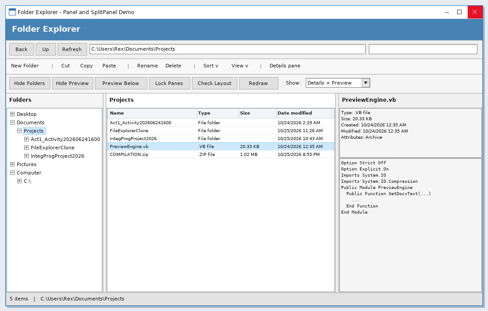

## Form Design

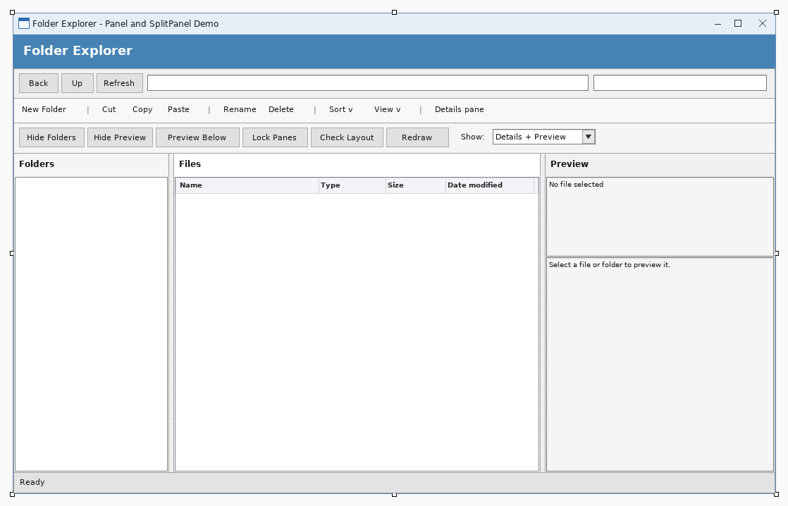

---

# Activity 13

## Source Code

### `frmMain.vb`
```vbnet
Public Class frmMain

    Private Sub LogLine(ByVal text As String)
        Try
            IO.File.AppendAllText(IO.Path.Combine(Application.StartupPath, "forms_log.txt"), _
                Date.Now.ToString("HH:mm:ss") & "  " & text & vbCrLf)
        Catch
        End Try
    End Sub

    Private Sub frmMain_Load(ByVal sender As System.Object, ByVal e As System.EventArgs) Handles MyBase.Load
        Try
            toolstripUserInfo.Text = "UserInfo: Rex M. Alvarez  |  BSIT 3B"
            UpdateDateTime()
            Timer1.Interval = 1000
            Timer1.Start()
            lblStatusBar.Text = "Choose a form from the menu."
            LogLine("main form loaded")
        Catch ex As Exception
            LogLine("main load failed: " & ex.Message)
        End Try
    End Sub

    Private Sub Timer1_Tick(ByVal sender As System.Object, ByVal e As System.EventArgs) Handles Timer1.Tick
        Try
            UpdateDateTime()
        Catch
        End Try
    End Sub

    Private Sub UpdateDateTime()
        toolstripCurrentDate.Text = "CurrentDate: " & Date.Now.ToString("dddd, d MMMM yyyy")
        toolstripCurrentTime.Text = "Current Time: " & Date.Now.ToString("h:mm:ss tt")
    End Sub

    Private Sub SchedulesToolStripMenuItem_Click(ByVal sender As System.Object, ByVal e As System.EventArgs) Handles SchedulesToolStripMenuItem.Click
        ShowChild(GetType(frmSchedules))
    End Sub

    Private Sub AboutToolStripMenuItem_Click(ByVal sender As System.Object, ByVal e As System.EventArgs) Handles AboutToolStripMenuItem.Click
        ShowChild(GetType(frmAbout))
    End Sub

    Private Sub QuotesToolStripMenuItem_Click(ByVal sender As System.Object, ByVal e As System.EventArgs) Handles QuotesToolStripMenuItem.Click
        ShowChild(GetType(frmQuotes))
    End Sub

    Private Sub BibleVerseToolStripMenuItem_Click(ByVal sender As System.Object, ByVal e As System.EventArgs) Handles BibleVerseToolStripMenuItem.Click
        ShowChild(GetType(frmBibleVerses))
    End Sub

    Private Sub ExitToolStripMenuItem_Click(ByVal sender As System.Object, ByVal e As System.EventArgs) Handles ExitToolStripMenuItem.Click
        If MessageBox.Show("Close the program?", "Exit", MessageBoxButtons.YesNo, MessageBoxIcon.Question) = DialogResult.Yes Then
            Me.Close()
        End If
    End Sub

    Private Sub ShowChild(ByVal formType As Type)
        LogLine("opening " & formType.Name)
        Try
            For Each openForm As Form In Me.MdiChildren
                If openForm.GetType() Is formType Then
                    openForm.Activate()
                    lblStatusBar.Text = "Form: " & openForm.Text
                    LogLine(formType.Name & " already open - activated")
                    Return
                End If
            Next
            Dim child As Form = CType(Activator.CreateInstance(formType), Form)
            child.MdiParent = Me
            child.Show()
            child.WindowState = FormWindowState.Maximized
            lblStatusBar.Text = "Form: " & child.Text
            LogLine(formType.Name & " shown inside main form, Visible=" & child.Visible.ToString())
        Catch ex As Exception
            LogLine(formType.Name & " FAILED: " & ex.GetType().Name & " - " & ex.Message)
            Try
                MessageBox.Show("The form could not be opened." & vbCrLf & vbCrLf & _
                    "Form: " & formType.Name & vbCrLf & vbCrLf & _
                    "Details: " & ex.Message, "Form Error", MessageBoxButtons.OK, MessageBoxIcon.Error)
            Catch
            End Try
        End Try
    End Sub

End Class
```

### `frmSchedules.vb`
```vbnet
Imports System.Data.OleDb

Public Class frmSchedules

    Private selectedId As Integer = 0
    Private isLoading As Boolean = False
    Private store As DataTable
    Private nextId As Integer = 1

    Private Sub LogStep(ByVal text As String)
        Try
            IO.File.AppendAllText(IO.Path.Combine(Application.StartupPath, "forms_log.txt"), _
                Date.Now.ToString("HH:mm:ss") & "  [frmSchedules] " & text & vbCrLf)
        Catch
        End Try
    End Sub

    Private Function XmlPath() As String
        Return IO.Path.Combine(Application.StartupPath, "projectDB.xml")
    End Function

    Private Function SdfPath() As String
        Return IO.Path.Combine(Application.StartupPath, "projectDB.sdf")
    End Function

    Private Function HasSqlCe() As Boolean
        Try
            Using key As Microsoft.Win32.RegistryKey = Microsoft.Win32.Registry.LocalMachine.OpenSubKey("SOFTWARE\Classes\Microsoft.SQLSERVER.CE.OLEDB.3.5")
                If key IsNot Nothing Then Return True
            End Using
            Using key As Microsoft.Win32.RegistryKey = Microsoft.Win32.Registry.LocalMachine.OpenSubKey("SOFTWARE\Wow6432Node\Classes\Microsoft.SQLSERVER.CE.OLEDB.3.5")
                If key IsNot Nothing Then Return True
            End Using
        Catch
        End Try
        Return False
    End Function

    Private Sub frmSchedules_Load(ByVal sender As System.Object, ByVal e As System.EventArgs) Handles MyBase.Load
        LogStep("Load")
        Try
            SetupStore()
        Catch ex As Exception
            LogStep("SetupStore failed: " & ex.Message)
        End Try
        Try
            ClearFields()
        Catch
        End Try
        RefreshGrid()
    End Sub

    Private Sub SetupStore()
        store = New DataTable("Schedules")
        store.Columns.Add("ScheduleID", GetType(Integer))
        store.Columns.Add("CourseID", GetType(String))
        store.Columns.Add("TeacherID", GetType(String))
        store.Columns.Add("Day", GetType(String))
        store.Columns.Add("Time", GetType(String))
        store.Columns.Add("Room", GetType(String))
        If IO.File.Exists(XmlPath()) Then
            Try
                store.ReadXml(XmlPath())
                LogStep("loaded rows from xml: " & store.Rows.Count.ToString())
            Catch ex As Exception
                LogStep("xml unreadable, reseeding: " & ex.Message)
                store.Clear()
            End Try
        End If
        If store.Rows.Count = 0 Then
            SeedSampleData()
            SaveStore()
            LogStep("seeded sample data")
        End If
        nextId = 1
        For Each row As DataRow In store.Rows
            Dim id As Integer = Convert.ToInt32(row.Item("ScheduleID"))
            If id >= nextId Then nextId = id + 1
        Next
        lblDatabase.Text = "Storage: " & XmlPath() & "   |   " & store.Rows.Count.ToString() & " record(s)"
    End Sub

    Private Sub SaveStore()
        Try
            store.AcceptChanges()
            store.WriteXml(XmlPath())
        Catch ex As Exception
            LogStep("WriteXml failed: " & ex.Message)
        End Try
        SyncToSdf()
    End Sub

    Private Sub SyncToSdf()
        If Not HasSqlCe() Then Return
        Try
            If Not IO.File.Exists(SdfPath()) Then
                Dim catalog As Object = CreateObject("ADOX.Catalog")
                catalog.Create("Provider=Microsoft.SQLSERVER.CE.OLEDB.3.5;Data Source=" & SdfPath())
                catalog = Nothing
            End If
            Using conn As New OleDbConnection("Provider=Microsoft.SQLSERVER.CE.OLEDB.3.5;Data Source=" & SdfPath() & ";Persist Security Info=False;")
                conn.Open()
                Using cmd As New OleDbCommand("SELECT COUNT(*) FROM [Schedules]", conn)
                    cmd.ExecuteScalar()
                End Using
                Using cmd As New OleDbCommand("DELETE FROM [Schedules]", conn)
                    cmd.ExecuteNonQuery()
                End Using
                For Each row As DataRow In store.Rows
                    Using cmd As New OleDbCommand("INSERT INTO [Schedules] ([CourseID], [TeacherID], [Day], [Time], [Room]) VALUES (?, ?, ?, ?, ?)", conn)
                        cmd.Parameters.AddWithValue("?", Convert.ToString(row.Item("CourseID")))
                        cmd.Parameters.AddWithValue("?", Convert.ToString(row.Item("TeacherID")))
                        cmd.Parameters.AddWithValue("?", Convert.ToString(row.Item("Day")))
                        cmd.Parameters.AddWithValue("?", Convert.ToString(row.Item("Time")))
                        cmd.Parameters.AddWithValue("?", Convert.ToString(row.Item("Room")))
                        cmd.ExecuteNonQuery()
                    End Using
                Next
            End Using
        Catch ex As Exception
            LogStep("sdf mirror skipped: " & ex.Message)
        End Try
    End Sub

    Private Sub SeedSampleData()
        Dim rows As String() = New String() { _
            "IT301|T-005|Monday|07:30|Room 205", _
            "IT302|T-006|Monday|11:00|Lab 3", _
            "CS201|T-007|Tuesday|09:30|Room 206", _
            "IT303|T-005|Wednesday|08:00|Lab 4", _
            "CS202|T-006|Thursday|13:30|Room 207", _
            "IT304|T-007|Friday|10:00|Room 208", _
            "CS203|T-005|Saturday|09:00|Lab 5"
            }
        For Each line As String In rows
            Dim parts As String() = line.Split("|"c)
            If parts.Length = 5 Then
                Dim row As DataRow = store.NewRow()
                row.Item("ScheduleID") = nextId
                row.Item("CourseID") = parts(0)
                row.Item("TeacherID") = parts(1)
                row.Item("Day") = parts(2)
                row.Item("Time") = parts(3)
                row.Item("Room") = parts(4)
                store.Rows.Add(row)
                nextId += 1
            End If
        Next
    End Sub

    Private Sub RefreshGrid()
        Try
            If store Is Nothing Then Return
            Dim view As New DataTable("Schedules")
            view = store.Copy()
            dataGridView1.DataSource = view
            FormatGrid()
            lblDatabase.Text = "Storage: " & XmlPath() & "   |   " & store.Rows.Count.ToString() & " record(s)"
        Catch ex As Exception
            LogStep("RefreshGrid failed: " & ex.Message)
        End Try
    End Sub

    Private Sub FormatGrid()
        If dataGridView1.Columns.Count = 0 Then Return
        With dataGridView1
            .Columns("ScheduleID").HeaderText = "ID"
            .Columns("CourseID").HeaderText = "Course ID"
            .Columns("TeacherID").HeaderText = "Teacher ID"
            .Columns("Day").HeaderText = "Day"
            .Columns("Time").HeaderText = "Time"
            .Columns("Room").HeaderText = "Room"
        End With
    End Sub

    Private Sub addButton_Click(ByVal sender As System.Object, ByVal e As System.EventArgs) Handles addButton.Click
        Try
            If Not IsValidInput() Then Return
            Dim row As DataRow = store.NewRow()
            row.Item("ScheduleID") = nextId
            row.Item("CourseID") = txtCourseID.Text.Trim()
            row.Item("TeacherID") = txtTeacherID.Text.Trim()
            row.Item("Day") = cboDay.Text.Trim()
            row.Item("Time") = dtpTime.Value.ToString("HH:mm")
            row.Item("Room") = txtRoom.Text.Trim()
            store.Rows.Add(row)
            nextId += 1
            SaveStore()
            MessageBox.Show("The record was saved." & vbCrLf & vbCrLf & "New ID: " & (nextId - 1).ToString(), _
                "Record Added", MessageBoxButtons.OK, MessageBoxIcon.Information)
            ClearFields()
            RefreshGrid()
        Catch ex As Exception
            LogStep("Add failed: " & ex.Message)
            MessageBox.Show("The record could not be saved." & vbCrLf & vbCrLf & ex.Message, _
                "Save Error", MessageBoxButtons.OK, MessageBoxIcon.Warning)
        End Try
    End Sub

    Private Sub updateButton_Click(ByVal sender As System.Object, ByVal e As System.EventArgs) Handles updateButton.Click
        Try
            If selectedId = 0 Then
                MessageBox.Show("Select a record in the table first.", "No Record Selected", _
                    MessageBoxButtons.OK, MessageBoxIcon.Information)
                Return
            End If
            If Not IsValidInput() Then Return
            Dim found As DataRow = Nothing
            For Each row As DataRow In store.Rows
                If Convert.ToInt32(row.Item("ScheduleID")) = selectedId Then
                    found = row
                    Exit For
                End If
            Next
            If found Is Nothing Then
                MessageBox.Show("That record no longer exists.", "Record Not Found", _
                    MessageBoxButtons.OK, MessageBoxIcon.Warning)
                RefreshGrid()
                Return
            End If
            found.Item("CourseID") = txtCourseID.Text.Trim()
            found.Item("TeacherID") = txtTeacherID.Text.Trim()
            found.Item("Day") = cboDay.Text.Trim()
            found.Item("Time") = dtpTime.Value.ToString("HH:mm")
            found.Item("Room") = txtRoom.Text.Trim()
            SaveStore()
            MessageBox.Show("The record was updated.", "Record Updated", MessageBoxButtons.OK, MessageBoxIcon.Information)
            ClearFields()
            RefreshGrid()
        Catch ex As Exception
            LogStep("Update failed: " & ex.Message)
            MessageBox.Show("The record could not be updated." & vbCrLf & vbCrLf & ex.Message, _
                "Update Error", MessageBoxButtons.OK, MessageBoxIcon.Warning)
        End Try
    End Sub

    Private Sub deleteButton_Click(ByVal sender As System.Object, ByVal e As System.EventArgs) Handles deleteButton.Click
        Try
            If selectedId = 0 Then
                MessageBox.Show("Select a record in the table first.", "No Record Selected", _
                    MessageBoxButtons.OK, MessageBoxIcon.Information)
                Return
            End If
            If MessageBox.Show("Delete this record?" & vbCrLf & vbCrLf & "ID: " & selectedId.ToString(), _
                    "Confirm Delete", MessageBoxButtons.YesNo, MessageBoxIcon.Question) <> DialogResult.Yes Then
                Return
            End If
            For i As Integer = store.Rows.Count - 1 To 0 Step -1
                If Convert.ToInt32(store.Rows(i).Item("ScheduleID")) = selectedId Then
                    store.Rows.RemoveAt(i)
                End If
            Next
            SaveStore()
            MessageBox.Show("The record was deleted.", "Record Deleted", MessageBoxButtons.OK, MessageBoxIcon.Information)
            ClearFields()
            RefreshGrid()
        Catch ex As Exception
            LogStep("Delete failed: " & ex.Message)
            MessageBox.Show("The record could not be deleted." & vbCrLf & vbCrLf & ex.Message, _
                "Delete Error", MessageBoxButtons.OK, MessageBoxIcon.Warning)
        End Try
    End Sub

    Private Sub clearButton_Click(ByVal sender As System.Object, ByVal e As System.EventArgs) Handles clearButton.Click
        ClearFields()
    End Sub

    Private Sub exitButton_Click(ByVal sender As System.Object, ByVal e As System.EventArgs) Handles exitButton.Click
        Me.Close()
    End Sub

    Private Sub dataGridView1_SelectionChanged(ByVal sender As System.Object, ByVal e As System.EventArgs) Handles dataGridView1.SelectionChanged
        If isLoading Then Return
        If dataGridView1.CurrentRow Is Nothing Then Return
        FillFromRow()
    End Sub

    Private Sub FillFromRow()
        Dim row As DataGridViewRow = dataGridView1.CurrentRow
        If row Is Nothing Then Return
        If row.Cells("ScheduleID").Value Is Nothing Then Return
        If row.Cells("ScheduleID").Value Is DBNull.Value Then Return
        isLoading = True
        Try
            selectedId = Convert.ToInt32(row.Cells("ScheduleID").Value)
            txtScheduleID.Text = selectedId.ToString()
            txtCourseID.Text = Convert.ToString(row.Cells("CourseID").Value)
            txtTeacherID.Text = Convert.ToString(row.Cells("TeacherID").Value)
            cboDay.Text = Convert.ToString(row.Cells("Day").Value)
            Dim TimeText As String = Convert.ToString(row.Cells("Time").Value)
            Dim TimeParsed As Date
            If Date.TryParse(DateTime.Today.ToShortDateString() & " " & TimeText, TimeParsed) Then
                dtpTime.Value = TimeParsed
            End If
            txtRoom.Text = Convert.ToString(row.Cells("Room").Value)
        Catch ex As Exception
            LogStep("FillFromRow failed: " & ex.Message)
        Finally
            isLoading = False
        End Try
    End Sub

    Private Sub ClearFields()
        isLoading = True
        Try
            dataGridView1.CurrentCell = Nothing
        Catch
        End Try
        selectedId = 0
        txtScheduleID.Clear()
        txtCourseID.Clear()
        txtTeacherID.Clear()
        cboDay.SelectedIndex = -1
        dtpTime.Value = DateTime.Today.AddHours(8)
        txtRoom.Clear()
        txtCourseID.Focus()
        isLoading = False
    End Sub

    Private Function IsValidInput() As Boolean
        If txtCourseID.Text.Trim() = "" Then
            MessageBox.Show("Please enter the Course ID.", "Missing Information", MessageBoxButtons.OK, MessageBoxIcon.Exclamation)
            txtCourseID.Focus()
            Return False
        End If
        If txtTeacherID.Text.Trim() = "" Then
            MessageBox.Show("Please enter the Teacher ID.", "Missing Information", MessageBoxButtons.OK, MessageBoxIcon.Exclamation)
            txtTeacherID.Focus()
            Return False
        End If
        If cboDay.SelectedIndex < 0 Then
            MessageBox.Show("Please choose the Day.", "Missing Information", MessageBoxButtons.OK, MessageBoxIcon.Exclamation)
            cboDay.Focus()
            Return False
        End If
        If txtRoom.Text.Trim() = "" Then
            MessageBox.Show("Please enter the Room.", "Missing Information", MessageBoxButtons.OK, MessageBoxIcon.Exclamation)
            txtRoom.Focus()
            Return False
        End If
        Return True
    End Function


    Private Function IntValue(ByVal text As String) As Integer
        Dim value As Integer = 0
        If Integer.TryParse(text.Trim(), value) Then Return value
        Return 0
    End Function

    Private Function DateValue(ByVal text As String) As Date
        Dim parts As String() = text.Split("-"c)
        If parts.Length = 3 Then
            Dim y As Integer = 0
            Dim m As Integer = 0
            Dim d As Integer = 0
            If Integer.TryParse(parts(0), y) AndAlso Integer.TryParse(parts(1), m) AndAlso Integer.TryParse(parts(2), d) Then
                If y >= 1 AndAlso m >= 1 AndAlso m <= 12 AndAlso d >= 1 AndAlso d <= 31 Then
                    Return New Date(y, m, d)
                End If
            End If
        End If
        Return Date.Today
    End Function

End Class
```

### `frmQuotes.vb`
```vbnet
Imports System.Data.OleDb

Public Class frmQuotes

    Private selectedId As Integer = 0
    Private isLoading As Boolean = False
    Private store As DataTable
    Private nextId As Integer = 1

    Private Sub LogStep(ByVal text As String)
        Try
            IO.File.AppendAllText(IO.Path.Combine(Application.StartupPath, "forms_log.txt"), _
                Date.Now.ToString("HH:mm:ss") & "  [frmQuotes] " & text & vbCrLf)
        Catch
        End Try
    End Sub

    Private Function XmlPath() As String
        Return IO.Path.Combine(Application.StartupPath, "projectDB.xml")
    End Function

    Private Function SdfPath() As String
        Return IO.Path.Combine(Application.StartupPath, "projectDB.sdf")
    End Function

    Private Function HasSqlCe() As Boolean
        Try
            Using key As Microsoft.Win32.RegistryKey = Microsoft.Win32.Registry.LocalMachine.OpenSubKey("SOFTWARE\Classes\Microsoft.SQLSERVER.CE.OLEDB.3.5")
                If key IsNot Nothing Then Return True
            End Using
            Using key As Microsoft.Win32.RegistryKey = Microsoft.Win32.Registry.LocalMachine.OpenSubKey("SOFTWARE\Wow6432Node\Classes\Microsoft.SQLSERVER.CE.OLEDB.3.5")
                If key IsNot Nothing Then Return True
            End Using
        Catch
        End Try
        Return False
    End Function

    Private Sub frmQuotes_Load(ByVal sender As System.Object, ByVal e As System.EventArgs) Handles MyBase.Load
        LogStep("Load")
        Try
            SetupStore()
        Catch ex As Exception
            LogStep("SetupStore failed: " & ex.Message)
        End Try
        Try
            ClearFields()
        Catch
        End Try
        RefreshGrid()
    End Sub

    Private Sub SetupStore()
        store = New DataTable("Quotes")
        store.Columns.Add("QuoteID", GetType(Integer))
        store.Columns.Add("Content", GetType(String))
        store.Columns.Add("Author", GetType(String))
        store.Columns.Add("Source", GetType(String))
        store.Columns.Add("QuoteDate", GetType(Date))
        If IO.File.Exists(XmlPath()) Then
            Try
                store.ReadXml(XmlPath())
                LogStep("loaded rows from xml: " & store.Rows.Count.ToString())
            Catch ex As Exception
                LogStep("xml unreadable, reseeding: " & ex.Message)
                store.Clear()
            End Try
        End If
        If store.Rows.Count = 0 Then
            SeedSampleData()
            SaveStore()
            LogStep("seeded sample data")
        End If
        nextId = 1
        For Each row As DataRow In store.Rows
            Dim id As Integer = Convert.ToInt32(row.Item("QuoteID"))
            If id >= nextId Then nextId = id + 1
        Next
        lblDatabase.Text = "Storage: " & XmlPath() & "   |   " & store.Rows.Count.ToString() & " record(s)"
    End Sub

    Private Sub SaveStore()
        Try
            store.AcceptChanges()
            store.WriteXml(XmlPath())
        Catch ex As Exception
            LogStep("WriteXml failed: " & ex.Message)
        End Try
        SyncToSdf()
    End Sub

    Private Sub SyncToSdf()
        If Not HasSqlCe() Then Return
        Try
            If Not IO.File.Exists(SdfPath()) Then
                Dim catalog As Object = CreateObject("ADOX.Catalog")
                catalog.Create("Provider=Microsoft.SQLSERVER.CE.OLEDB.3.5;Data Source=" & SdfPath())
                catalog = Nothing
            End If
            Using conn As New OleDbConnection("Provider=Microsoft.SQLSERVER.CE.OLEDB.3.5;Data Source=" & SdfPath() & ";Persist Security Info=False;")
                conn.Open()
                Using cmd As New OleDbCommand("SELECT COUNT(*) FROM [Quotes]", conn)
                    cmd.ExecuteScalar()
                End Using
                Using cmd As New OleDbCommand("DELETE FROM [Quotes]", conn)
                    cmd.ExecuteNonQuery()
                End Using
                For Each row As DataRow In store.Rows
                    Using cmd As New OleDbCommand("INSERT INTO [Quotes] ([Content], [Author], [Source], [QuoteDate]) VALUES (?, ?, ?, ?)", conn)
                        cmd.Parameters.AddWithValue("?", Convert.ToString(row.Item("Content")))
                        cmd.Parameters.AddWithValue("?", Convert.ToString(row.Item("Author")))
                        cmd.Parameters.AddWithValue("?", Convert.ToString(row.Item("Source")))
                        cmd.Parameters.AddWithValue("?", Convert.ToDateTime(row.Item("QuoteDate")))
                        cmd.ExecuteNonQuery()
                    End Using
                Next
            End Using
        Catch ex As Exception
            LogStep("sdf mirror skipped: " & ex.Message)
        End Try
    End Sub

    Private Sub SeedSampleData()
        Dim rows As String() = New String() { _
            "Simplicity is the soul of efficiency.|Austin Freeman|The Social Welfare of the Blind|1912-01-01", _
            "First, solve the problem. Then, write the code.|John Johnson|Tech talk|1980-05-20", _
            "Experience is the name everyone gives to their mistakes.|Oscar Wilde|Lady Windermere Fan|1892-02-20", _
            "Code is like humor. When you have to explain it, it is bad.|Cory House|Blog post|2015-03-11", _
            "Make it work, make it right, make it fast.|Kent Beck|Extreme Programming|1999-10-05", _
            "The best error message is the one that never shows up.|Thomas Fuchs|Conference talk|2011-07-19"
            }
        For Each line As String In rows
            Dim parts As String() = line.Split("|"c)
            If parts.Length = 4 Then
                Dim row As DataRow = store.NewRow()
                row.Item("QuoteID") = nextId
                row.Item("Content") = parts(0)
                row.Item("Author") = parts(1)
                row.Item("Source") = parts(2)
                row.Item("QuoteDate") = DateValue(parts(3))
                store.Rows.Add(row)
                nextId += 1
            End If
        Next
    End Sub

    Private Sub RefreshGrid()
        Try
            If store Is Nothing Then Return
            Dim view As New DataTable("Quotes")
            view = store.Copy()
            dataGridView1.DataSource = view
            FormatGrid()
            lblDatabase.Text = "Storage: " & XmlPath() & "   |   " & store.Rows.Count.ToString() & " record(s)"
        Catch ex As Exception
            LogStep("RefreshGrid failed: " & ex.Message)
        End Try
    End Sub

    Private Sub FormatGrid()
        If dataGridView1.Columns.Count = 0 Then Return
        With dataGridView1
            .Columns("QuoteID").HeaderText = "ID"
            .Columns("Content").HeaderText = "Content"
            .Columns("Author").HeaderText = "Author"
            .Columns("Source").HeaderText = "Source"
            .Columns("QuoteDate").HeaderText = "Quote Date"
        End With
    End Sub

    Private Sub addButton_Click(ByVal sender As System.Object, ByVal e As System.EventArgs) Handles addButton.Click
        Try
            If Not IsValidInput() Then Return
            Dim row As DataRow = store.NewRow()
            row.Item("QuoteID") = nextId
            row.Item("Content") = txtContent.Text.Trim()
            row.Item("Author") = txtAuthor.Text.Trim()
            row.Item("Source") = txtSource.Text.Trim()
            row.Item("QuoteDate") = dtpQuoteDate.Value.Date
            store.Rows.Add(row)
            nextId += 1
            SaveStore()
            MessageBox.Show("The record was saved." & vbCrLf & vbCrLf & "New ID: " & (nextId - 1).ToString(), _
                "Record Added", MessageBoxButtons.OK, MessageBoxIcon.Information)
            ClearFields()
            RefreshGrid()
        Catch ex As Exception
            LogStep("Add failed: " & ex.Message)
            MessageBox.Show("The record could not be saved." & vbCrLf & vbCrLf & ex.Message, _
                "Save Error", MessageBoxButtons.OK, MessageBoxIcon.Warning)
        End Try
    End Sub

    Private Sub updateButton_Click(ByVal sender As System.Object, ByVal e As System.EventArgs) Handles updateButton.Click
        Try
            If selectedId = 0 Then
                MessageBox.Show("Select a record in the table first.", "No Record Selected", _
                    MessageBoxButtons.OK, MessageBoxIcon.Information)
                Return
            End If
            If Not IsValidInput() Then Return
            Dim found As DataRow = Nothing
            For Each row As DataRow In store.Rows
                If Convert.ToInt32(row.Item("QuoteID")) = selectedId Then
                    found = row
                    Exit For
                End If
            Next
            If found Is Nothing Then
                MessageBox.Show("That record no longer exists.", "Record Not Found", _
                    MessageBoxButtons.OK, MessageBoxIcon.Warning)
                RefreshGrid()
                Return
            End If
            found.Item("Content") = txtContent.Text.Trim()
            found.Item("Author") = txtAuthor.Text.Trim()
            found.Item("Source") = txtSource.Text.Trim()
            found.Item("QuoteDate") = dtpQuoteDate.Value.Date
            SaveStore()
            MessageBox.Show("The record was updated.", "Record Updated", MessageBoxButtons.OK, MessageBoxIcon.Information)
            ClearFields()
            RefreshGrid()
        Catch ex As Exception
            LogStep("Update failed: " & ex.Message)
            MessageBox.Show("The record could not be updated." & vbCrLf & vbCrLf & ex.Message, _
                "Update Error", MessageBoxButtons.OK, MessageBoxIcon.Warning)
        End Try
    End Sub

    Private Sub deleteButton_Click(ByVal sender As System.Object, ByVal e As System.EventArgs) Handles deleteButton.Click
        Try
            If selectedId = 0 Then
                MessageBox.Show("Select a record in the table first.", "No Record Selected", _
                    MessageBoxButtons.OK, MessageBoxIcon.Information)
                Return
            End If
            If MessageBox.Show("Delete this record?" & vbCrLf & vbCrLf & "ID: " & selectedId.ToString(), _
                    "Confirm Delete", MessageBoxButtons.YesNo, MessageBoxIcon.Question) <> DialogResult.Yes Then
                Return
            End If
            For i As Integer = store.Rows.Count - 1 To 0 Step -1
                If Convert.ToInt32(store.Rows(i).Item("QuoteID")) = selectedId Then
                    store.Rows.RemoveAt(i)
                End If
            Next
            SaveStore()
            MessageBox.Show("The record was deleted.", "Record Deleted", MessageBoxButtons.OK, MessageBoxIcon.Information)
            ClearFields()
            RefreshGrid()
        Catch ex As Exception
            LogStep("Delete failed: " & ex.Message)
            MessageBox.Show("The record could not be deleted." & vbCrLf & vbCrLf & ex.Message, _
                "Delete Error", MessageBoxButtons.OK, MessageBoxIcon.Warning)
        End Try
    End Sub

    Private Sub clearButton_Click(ByVal sender As System.Object, ByVal e As System.EventArgs) Handles clearButton.Click
        ClearFields()
    End Sub

    Private Sub exitButton_Click(ByVal sender As System.Object, ByVal e As System.EventArgs) Handles exitButton.Click
        Me.Close()
    End Sub

    Private Sub dataGridView1_SelectionChanged(ByVal sender As System.Object, ByVal e As System.EventArgs) Handles dataGridView1.SelectionChanged
        If isLoading Then Return
        If dataGridView1.CurrentRow Is Nothing Then Return
        FillFromRow()
    End Sub

    Private Sub FillFromRow()
        Dim row As DataGridViewRow = dataGridView1.CurrentRow
        If row Is Nothing Then Return
        If row.Cells("QuoteID").Value Is Nothing Then Return
        If row.Cells("QuoteID").Value Is DBNull.Value Then Return
        isLoading = True
        Try
            selectedId = Convert.ToInt32(row.Cells("QuoteID").Value)
            txtQuoteID.Text = selectedId.ToString()
            txtContent.Text = Convert.ToString(row.Cells("Content").Value)
            txtAuthor.Text = Convert.ToString(row.Cells("Author").Value)
            txtSource.Text = Convert.ToString(row.Cells("Source").Value)
            Dim QuoteDateDate As Date
            If Date.TryParse(Convert.ToString(row.Cells("QuoteDate").Value), QuoteDateDate) Then
                dtpQuoteDate.Value = QuoteDateDate
            End If
        Catch ex As Exception
            LogStep("FillFromRow failed: " & ex.Message)
        Finally
            isLoading = False
        End Try
    End Sub

    Private Sub ClearFields()
        isLoading = True
        Try
            dataGridView1.CurrentCell = Nothing
        Catch
        End Try
        selectedId = 0
        txtQuoteID.Clear()
        txtContent.Clear()
        txtAuthor.Clear()
        txtSource.Clear()
        dtpQuoteDate.Value = Date.Today
        txtContent.Focus()
        isLoading = False
    End Sub

    Private Function IsValidInput() As Boolean
        If txtContent.Text.Trim() = "" Then
            MessageBox.Show("Please enter the Content.", "Missing Information", MessageBoxButtons.OK, MessageBoxIcon.Exclamation)
            txtContent.Focus()
            Return False
        End If
        If txtAuthor.Text.Trim() = "" Then
            MessageBox.Show("Please enter the Author.", "Missing Information", MessageBoxButtons.OK, MessageBoxIcon.Exclamation)
            txtAuthor.Focus()
            Return False
        End If
        Return True
    End Function


    Private Function IntValue(ByVal text As String) As Integer
        Dim value As Integer = 0
        If Integer.TryParse(text.Trim(), value) Then Return value
        Return 0
    End Function

    Private Function DateValue(ByVal text As String) As Date
        Dim parts As String() = text.Split("-"c)
        If parts.Length = 3 Then
            Dim y As Integer = 0
            Dim m As Integer = 0
            Dim d As Integer = 0
            If Integer.TryParse(parts(0), y) AndAlso Integer.TryParse(parts(1), m) AndAlso Integer.TryParse(parts(2), d) Then
                If y >= 1 AndAlso m >= 1 AndAlso m <= 12 AndAlso d >= 1 AndAlso d <= 31 Then
                    Return New Date(y, m, d)
                End If
            End If
        End If
        Return Date.Today
    End Function

End Class
```

### `frmBibleVerses.vb`
```vbnet
Imports System.Data.OleDb

Public Class frmBibleVerses

    Private selectedId As Integer = 0
    Private isLoading As Boolean = False
    Private store As DataTable
    Private nextId As Integer = 1

    Private Sub LogStep(ByVal text As String)
        Try
            IO.File.AppendAllText(IO.Path.Combine(Application.StartupPath, "forms_log.txt"), _
                Date.Now.ToString("HH:mm:ss") & "  [frmBibleVerses] " & text & vbCrLf)
        Catch
        End Try
    End Sub

    Private Function XmlPath() As String
        Return IO.Path.Combine(Application.StartupPath, "projectDB.xml")
    End Function

    Private Function SdfPath() As String
        Return IO.Path.Combine(Application.StartupPath, "projectDB.sdf")
    End Function

    Private Function HasSqlCe() As Boolean
        Try
            Using key As Microsoft.Win32.RegistryKey = Microsoft.Win32.Registry.LocalMachine.OpenSubKey("SOFTWARE\Classes\Microsoft.SQLSERVER.CE.OLEDB.3.5")
                If key IsNot Nothing Then Return True
            End Using
            Using key As Microsoft.Win32.RegistryKey = Microsoft.Win32.Registry.LocalMachine.OpenSubKey("SOFTWARE\Wow6432Node\Classes\Microsoft.SQLSERVER.CE.OLEDB.3.5")
                If key IsNot Nothing Then Return True
            End Using
        Catch
        End Try
        Return False
    End Function

    Private Sub frmBibleVerses_Load(ByVal sender As System.Object, ByVal e As System.EventArgs) Handles MyBase.Load
        LogStep("Load")
        Try
            SetupStore()
        Catch ex As Exception
            LogStep("SetupStore failed: " & ex.Message)
        End Try
        Try
            ClearFields()
        Catch
        End Try
        RefreshGrid()
    End Sub

    Private Sub SetupStore()
        store = New DataTable("BibleVerses")
        store.Columns.Add("VerseID", GetType(Integer))
        store.Columns.Add("Book", GetType(String))
        store.Columns.Add("Chapter", GetType(Integer))
        store.Columns.Add("Verse", GetType(Integer))
        store.Columns.Add("Content", GetType(String))
        store.Columns.Add("Translation", GetType(String))
        store.Columns.Add("Remarks", GetType(String))
        store.Columns.Add("Category", GetType(String))
        If IO.File.Exists(XmlPath()) Then
            Try
                store.ReadXml(XmlPath())
                LogStep("loaded rows from xml: " & store.Rows.Count.ToString())
            Catch ex As Exception
                LogStep("xml unreadable, reseeding: " & ex.Message)
                store.Clear()
            End Try
        End If
        If store.Rows.Count = 0 Then
            SeedSampleData()
            SaveStore()
            LogStep("seeded sample data")
        End If
        nextId = 1
        For Each row As DataRow In store.Rows
            Dim id As Integer = Convert.ToInt32(row.Item("VerseID"))
            If id >= nextId Then nextId = id + 1
        Next
        lblDatabase.Text = "Storage: " & XmlPath() & "   |   " & store.Rows.Count.ToString() & " record(s)"
    End Sub

    Private Sub SaveStore()
        Try
            store.AcceptChanges()
            store.WriteXml(XmlPath())
        Catch ex As Exception
            LogStep("WriteXml failed: " & ex.Message)
        End Try
        SyncToSdf()
    End Sub

    Private Sub SyncToSdf()
        If Not HasSqlCe() Then Return
        Try
            If Not IO.File.Exists(SdfPath()) Then
                Dim catalog As Object = CreateObject("ADOX.Catalog")
                catalog.Create("Provider=Microsoft.SQLSERVER.CE.OLEDB.3.5;Data Source=" & SdfPath())
                catalog = Nothing
            End If
            Using conn As New OleDbConnection("Provider=Microsoft.SQLSERVER.CE.OLEDB.3.5;Data Source=" & SdfPath() & ";Persist Security Info=False;")
                conn.Open()
                Using cmd As New OleDbCommand("SELECT COUNT(*) FROM [BibleVerses]", conn)
                    cmd.ExecuteScalar()
                End Using
                Using cmd As New OleDbCommand("DELETE FROM [BibleVerses]", conn)
                    cmd.ExecuteNonQuery()
                End Using
                For Each row As DataRow In store.Rows
                    Using cmd As New OleDbCommand("INSERT INTO [BibleVerses] ([Book], [Chapter], [Verse], [Content], [Translation], [Remarks], [Category]) VALUES (?, ?, ?, ?, ?, ?, ?)", conn)
                        cmd.Parameters.AddWithValue("?", Convert.ToString(row.Item("Book")))
                        cmd.Parameters.AddWithValue("?", IntValue(Convert.ToString(row.Item("Chapter"))))
                        cmd.Parameters.AddWithValue("?", IntValue(Convert.ToString(row.Item("Verse"))))
                        cmd.Parameters.AddWithValue("?", Convert.ToString(row.Item("Content")))
                        cmd.Parameters.AddWithValue("?", Convert.ToString(row.Item("Translation")))
                        cmd.Parameters.AddWithValue("?", Convert.ToString(row.Item("Remarks")))
                        cmd.Parameters.AddWithValue("?", Convert.ToString(row.Item("Category")))
                        cmd.ExecuteNonQuery()
                    End Using
                Next
            End Using
        Catch ex As Exception
            LogStep("sdf mirror skipped: " & ex.Message)
        End Try
    End Sub

    Private Sub SeedSampleData()
        Dim rows As String() = New String() { _
            "Genesis|1|1|In the beginning God created the heavens and the earth.|NIV|Creation|Old Testament", _
            "Exodus|20|3|You shall have no other gods before me.|NIV|Commandments|Old Testament", _
            "Joshua|1|9|Be strong and courageous. Do not be afraid.|NIV|Courage|History", _
            "Isaiah|41|10|So do not fear, for I am with you.|NIV|Comfort|Prophecy", _
            "Matthew|5|9|Blessed are the peacemakers.|NIV|Peace|Gospel", _
            "James|1|22|Do not merely listen to the word, and so deceive yourselves. Do what it says.|NIV|Action|Epistle"
            }
        For Each line As String In rows
            Dim parts As String() = line.Split("|"c)
            If parts.Length = 7 Then
                Dim row As DataRow = store.NewRow()
                row.Item("VerseID") = nextId
                row.Item("Book") = parts(0)
                row.Item("Chapter") = IntValue(parts(1))
                row.Item("Verse") = IntValue(parts(2))
                row.Item("Content") = parts(3)
                row.Item("Translation") = parts(4)
                row.Item("Remarks") = parts(5)
                row.Item("Category") = parts(6)
                store.Rows.Add(row)
                nextId += 1
            End If
        Next
    End Sub

    Private Sub RefreshGrid()
        Try
            If store Is Nothing Then Return
            Dim view As New DataTable("BibleVerses")
            view = store.Copy()
            dataGridView1.DataSource = view
            FormatGrid()
            lblDatabase.Text = "Storage: " & XmlPath() & "   |   " & store.Rows.Count.ToString() & " record(s)"
        Catch ex As Exception
            LogStep("RefreshGrid failed: " & ex.Message)
        End Try
    End Sub

    Private Sub FormatGrid()
        If dataGridView1.Columns.Count = 0 Then Return
        With dataGridView1
            .Columns("VerseID").HeaderText = "ID"
            .Columns("Book").HeaderText = "Book"
            .Columns("Chapter").HeaderText = "Chapter"
            .Columns("Verse").HeaderText = "Verse"
            .Columns("Content").HeaderText = "Content"
            .Columns("Translation").HeaderText = "Translation"
            .Columns("Remarks").HeaderText = "Remarks"
            .Columns("Category").HeaderText = "Category"
        End With
    End Sub

    Private Sub addButton_Click(ByVal sender As System.Object, ByVal e As System.EventArgs) Handles addButton.Click
        Try
            If Not IsValidInput() Then Return
            Dim row As DataRow = store.NewRow()
            row.Item("VerseID") = nextId
            row.Item("Book") = txtBook.Text.Trim()
            row.Item("Chapter") = IntValue(txtChapter.Text)
            row.Item("Verse") = IntValue(txtVerse.Text)
            row.Item("Content") = txtContent.Text.Trim()
            row.Item("Translation") = txtTranslation.Text.Trim()
            row.Item("Remarks") = txtRemarks.Text.Trim()
            row.Item("Category") = txtCategory.Text.Trim()
            store.Rows.Add(row)
            nextId += 1
            SaveStore()
            MessageBox.Show("The record was saved." & vbCrLf & vbCrLf & "New ID: " & (nextId - 1).ToString(), _
                "Record Added", MessageBoxButtons.OK, MessageBoxIcon.Information)
            ClearFields()
            RefreshGrid()
        Catch ex As Exception
            LogStep("Add failed: " & ex.Message)
            MessageBox.Show("The record could not be saved." & vbCrLf & vbCrLf & ex.Message, _
                "Save Error", MessageBoxButtons.OK, MessageBoxIcon.Warning)
        End Try
    End Sub

    Private Sub updateButton_Click(ByVal sender As System.Object, ByVal e As System.EventArgs) Handles updateButton.Click
        Try
            If selectedId = 0 Then
                MessageBox.Show("Select a record in the table first.", "No Record Selected", _
                    MessageBoxButtons.OK, MessageBoxIcon.Information)
                Return
            End If
            If Not IsValidInput() Then Return
            Dim found As DataRow = Nothing
            For Each row As DataRow In store.Rows
                If Convert.ToInt32(row.Item("VerseID")) = selectedId Then
                    found = row
                    Exit For
                End If
            Next
            If found Is Nothing Then
                MessageBox.Show("That record no longer exists.", "Record Not Found", _
                    MessageBoxButtons.OK, MessageBoxIcon.Warning)
                RefreshGrid()
                Return
            End If
            found.Item("Book") = txtBook.Text.Trim()
            found.Item("Chapter") = IntValue(txtChapter.Text)
            found.Item("Verse") = IntValue(txtVerse.Text)
            found.Item("Content") = txtContent.Text.Trim()
            found.Item("Translation") = txtTranslation.Text.Trim()
            found.Item("Remarks") = txtRemarks.Text.Trim()
            found.Item("Category") = txtCategory.Text.Trim()
            SaveStore()
            MessageBox.Show("The record was updated.", "Record Updated", MessageBoxButtons.OK, MessageBoxIcon.Information)
            ClearFields()
            RefreshGrid()
        Catch ex As Exception
            LogStep("Update failed: " & ex.Message)
            MessageBox.Show("The record could not be updated." & vbCrLf & vbCrLf & ex.Message, _
                "Update Error", MessageBoxButtons.OK, MessageBoxIcon.Warning)
        End Try
    End Sub

    Private Sub deleteButton_Click(ByVal sender As System.Object, ByVal e As System.EventArgs) Handles deleteButton.Click
        Try
            If selectedId = 0 Then
                MessageBox.Show("Select a record in the table first.", "No Record Selected", _
                    MessageBoxButtons.OK, MessageBoxIcon.Information)
                Return
            End If
            If MessageBox.Show("Delete this record?" & vbCrLf & vbCrLf & "ID: " & selectedId.ToString(), _
                    "Confirm Delete", MessageBoxButtons.YesNo, MessageBoxIcon.Question) <> DialogResult.Yes Then
                Return
            End If
            For i As Integer = store.Rows.Count - 1 To 0 Step -1
                If Convert.ToInt32(store.Rows(i).Item("VerseID")) = selectedId Then
                    store.Rows.RemoveAt(i)
                End If
            Next
            SaveStore()
            MessageBox.Show("The record was deleted.", "Record Deleted", MessageBoxButtons.OK, MessageBoxIcon.Information)
            ClearFields()
            RefreshGrid()
        Catch ex As Exception
            LogStep("Delete failed: " & ex.Message)
            MessageBox.Show("The record could not be deleted." & vbCrLf & vbCrLf & ex.Message, _
                "Delete Error", MessageBoxButtons.OK, MessageBoxIcon.Warning)
        End Try
    End Sub

    Private Sub clearButton_Click(ByVal sender As System.Object, ByVal e As System.EventArgs) Handles clearButton.Click
        ClearFields()
    End Sub

    Private Sub exitButton_Click(ByVal sender As System.Object, ByVal e As System.EventArgs) Handles exitButton.Click
        Me.Close()
    End Sub

    Private Sub dataGridView1_SelectionChanged(ByVal sender As System.Object, ByVal e As System.EventArgs) Handles dataGridView1.SelectionChanged
        If isLoading Then Return
        If dataGridView1.CurrentRow Is Nothing Then Return
        FillFromRow()
    End Sub

    Private Sub FillFromRow()
        Dim row As DataGridViewRow = dataGridView1.CurrentRow
        If row Is Nothing Then Return
        If row.Cells("VerseID").Value Is Nothing Then Return
        If row.Cells("VerseID").Value Is DBNull.Value Then Return
        isLoading = True
        Try
            selectedId = Convert.ToInt32(row.Cells("VerseID").Value)
            txtVerseID.Text = selectedId.ToString()
            txtBook.Text = Convert.ToString(row.Cells("Book").Value)
            txtChapter.Text = Convert.ToString(row.Cells("Chapter").Value)
            txtVerse.Text = Convert.ToString(row.Cells("Verse").Value)
            txtContent.Text = Convert.ToString(row.Cells("Content").Value)
            txtTranslation.Text = Convert.ToString(row.Cells("Translation").Value)
            txtRemarks.Text = Convert.ToString(row.Cells("Remarks").Value)
            txtCategory.Text = Convert.ToString(row.Cells("Category").Value)
        Catch ex As Exception
            LogStep("FillFromRow failed: " & ex.Message)
        Finally
            isLoading = False
        End Try
    End Sub

    Private Sub ClearFields()
        isLoading = True
        Try
            dataGridView1.CurrentCell = Nothing
        Catch
        End Try
        selectedId = 0
        txtVerseID.Clear()
        txtBook.Clear()
        txtChapter.Clear()
        txtVerse.Clear()
        txtContent.Clear()
        txtTranslation.Clear()
        txtRemarks.Clear()
        txtCategory.Clear()
        txtBook.Focus()
        isLoading = False
    End Sub

    Private Function IsValidInput() As Boolean
        If txtBook.Text.Trim() = "" Then
            MessageBox.Show("Please enter the Book.", "Missing Information", MessageBoxButtons.OK, MessageBoxIcon.Exclamation)
            txtBook.Focus()
            Return False
        End If
        If txtChapter.Text.Trim() = "" Then
            MessageBox.Show("Please enter the Chapter.", "Missing Information", MessageBoxButtons.OK, MessageBoxIcon.Exclamation)
            txtChapter.Focus()
            Return False
        End If
        Dim ChapterNum As Integer = 0
        If txtChapter.Text.Trim() <> "" AndAlso Not Integer.TryParse(txtChapter.Text.Trim(), ChapterNum) Then
            MessageBox.Show("The Chapter must be a whole number.", "Invalid Number", MessageBoxButtons.OK, MessageBoxIcon.Exclamation)
            txtChapter.Focus()
            Return False
        End If
        If txtVerse.Text.Trim() = "" Then
            MessageBox.Show("Please enter the Verse.", "Missing Information", MessageBoxButtons.OK, MessageBoxIcon.Exclamation)
            txtVerse.Focus()
            Return False
        End If
        Dim VerseNum As Integer = 0
        If txtVerse.Text.Trim() <> "" AndAlso Not Integer.TryParse(txtVerse.Text.Trim(), VerseNum) Then
            MessageBox.Show("The Verse must be a whole number.", "Invalid Number", MessageBoxButtons.OK, MessageBoxIcon.Exclamation)
            txtVerse.Focus()
            Return False
        End If
        If txtContent.Text.Trim() = "" Then
            MessageBox.Show("Please enter the Content.", "Missing Information", MessageBoxButtons.OK, MessageBoxIcon.Exclamation)
            txtContent.Focus()
            Return False
        End If
        If txtTranslation.Text.Trim() = "" Then
            MessageBox.Show("Please enter the Translation.", "Missing Information", MessageBoxButtons.OK, MessageBoxIcon.Exclamation)
            txtTranslation.Focus()
            Return False
        End If
        Return True
    End Function


    Private Function IntValue(ByVal text As String) As Integer
        Dim value As Integer = 0
        If Integer.TryParse(text.Trim(), value) Then Return value
        Return 0
    End Function

    Private Function DateValue(ByVal text As String) As Date
        Dim parts As String() = text.Split("-"c)
        If parts.Length = 3 Then
            Dim y As Integer = 0
            Dim m As Integer = 0
            Dim d As Integer = 0
            If Integer.TryParse(parts(0), y) AndAlso Integer.TryParse(parts(1), m) AndAlso Integer.TryParse(parts(2), d) Then
                If y >= 1 AndAlso m >= 1 AndAlso m <= 12 AndAlso d >= 1 AndAlso d <= 31 Then
                    Return New Date(y, m, d)
                End If
            End If
        End If
        Return Date.Today
    End Function

End Class
```

### `frmAbout.vb`
```vbnet
Public Class frmAbout

    Private Sub LogStep(ByVal text As String)
        Try
            IO.File.AppendAllText(IO.Path.Combine(Application.StartupPath, "forms_log.txt"), _
                Date.Now.ToString("HH:mm:ss") & "  [frmAbout] " & text & vbCrLf)
        Catch
        End Try
    End Sub

    Private Const PhotoData As String = ""

    Private Sub frmAbout_Load(ByVal sender As System.Object, ByVal e As System.EventArgs) Handles MyBase.Load
        LogStep("Load start")
        Try
            Dim bytes As Byte() = Convert.FromBase64String(PhotoData)
            Using stream As New IO.MemoryStream(bytes)
                Using photo As Image = Image.FromStream(stream)
                    PictureBox1.Image = New Bitmap(photo)
                End Using
            End Using
        Catch ex As Exception
        End Try
    LogStep("Load end")
    End Sub

End Class
```

## Sample Run

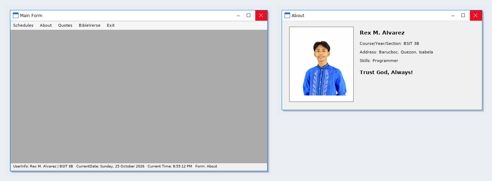

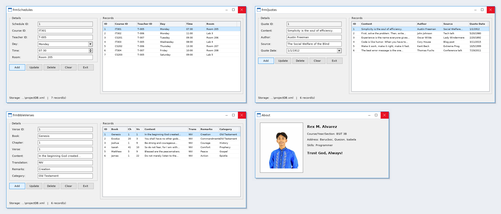

## Form Design

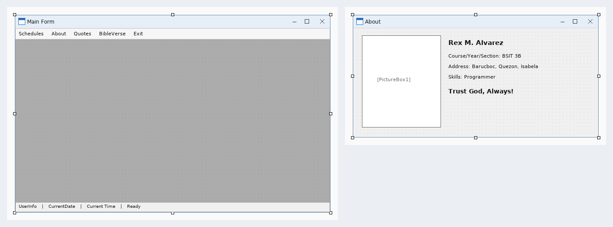

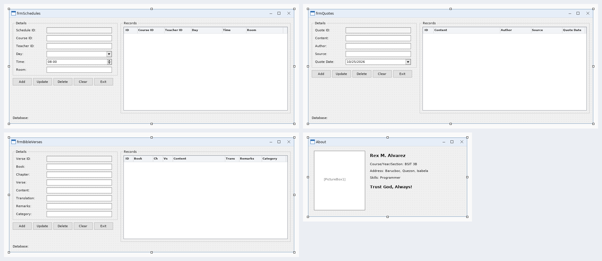

---
